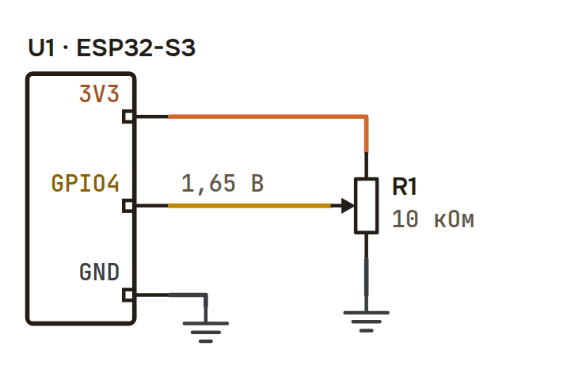
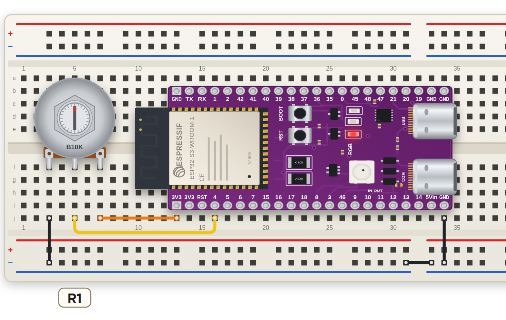

# ESP32-S3: формула проти калібрування АЦП — Модуль 3, урок 3.2 (ДЗ)

Потенціометр 10 кОм як подільник, повзунок на **GPIO4** (ADC1_CH3). Кожні 100 мс програма друкує сире число АЦП,
напругу за формулою `RAW × 3300 / 4095`, напругу з калібруванням eFuse (схема curve fitting) і похибку формули у
відсотках. Теорія і калькулятор — на [сторінці уроку 3.2](https://grok-rs.github.io/platformio-projects/lessons/3-2/).

```bash
cd esp32-s3-adc-cali/cpp  && pio run -t upload && pio device monitor                # C, ESP-IDF: src/main.c
cd esp32-s3-adc-cali/rust && source ~/export-esp.sh && cargo run --release          # Rust, ESP-IDF: src/main.rs
```

> **Статус.** Обидві прошивки зібрані (C на ESP-IDF 6.1.0, Rust на esp-idf-hal з ESP-IDF 5.5), на платі ще не
> запускалися. Жодного числа нижче з плати не знято.

## Схема





Обидві картинки — експорт розділу 08 сторінки уроку (`docs/tools/export.sh`), тож README і сайт показують ту саму
збірку. Те саме текстом:

```
3V3 ── ┐
       R1 10 кОм ── повзунок ── GPIO4 (ADC1_CH3)   (необов'язково: 100 нФ від GPIO4 до GND проти шуму)
GND ── ┘
```

| Деталь | Шт. |
|---|---|
| YD-ESP32-S3 (N16R8), кабель USB-C у порт **USB** | 1 |
| потенціометр 10 кОм | 1 |
| макетка, три дроти; бажано мультиметр і конденсатор 100 нФ (104) | — |

## Як це працює

```c
float manual = raw * V_FULL / 4095.0f;          // формула: лінійна, 0 → 0 мВ, 4095 → 3300 мВ
adc_cali_raw_to_voltage(cali, raw, &mv);        // калібрування: крива з eFuse саме цього чипа
float err = (manual - mv) * 100.0f / mv;        // похибка формули відносно калібрування
```

- Ослаблення 12 дБ (`ADC_ATTEN_DB_12`, старе ім'я `ADC_ATTEN_DB_11`), розрядність 12 біт. Калібрування створюється
  з тим самим ослабленням, що й канал, інакше мілівольти будуть хибні.
- Якщо в eFuse немає даних калібрування, C-версія друкує це й показує «-» у двох останніх стовпцях; Rust-версія
  зупиняється з помилкою `AdcChannelDriver::new()`. У чипів ESP32-S3 ці дані зазвичай є.
- Біля нуля `mv` може бути 0 — ділити на нього не можна, тому там теж «-».
- `V_FULL` 3300 — «ідеальна» шкала. Спробуйте 3100 (реальний верх при 12 дБ) і подивіться, як зміниться похибка.

Очікуваний вигляд виводу (не запис із плати):

```
ATTEN 12 дБ, 12 біт, curve fitting, V_FULL = 3300 мВ
 RAW  U_manual(mV)  U_cali(mV)  Error(%)
2051        1652.8        …         …
```

## Виміри (ATTEN 12 дБ, 12 біт, curve fitting)

| Положення | RAW | U_manual, мВ | U_cali, мВ | Похибка, % | Мультиметр, мВ |
|---|---|---|---|---|---|
| Упор біля GND | | | | | |
| ≈ 10 % | | | | | |
| ≈ 25 % | | | | | |
| ≈ 50 % | | | | | |
| ≈ 75 % | | | | | |
| ≈ 90 % | | | | | |
| Упор біля 3V3 | | | | | |

Біля упорів мають бути 0 і 4095. Мультиметр — незалежний еталон: якщо U_cali від нього далі, ніж обіцяє даташит,
перевірте землю й дроти.

Що якщо… `ADC_ATTEN_DB_6` і рядки до 1,5 В? Конденсатор 100 нФ — як «стрибає» останній знак RAW?

## C ↔ Rust

| | C (ESP-IDF 6.1) | Rust (esp-idf-hal, ESP-IDF 5.5) |
|---|---|---|
| Калібрування | `adc_cali_create_scheme_curve_fitting()` окремо від каналу | `calibration: Calibration::Curve` у конфігурації каналу |
| Сире число | `adc_oneshot_read()` | `pot.read_raw()?` |
| Мілівольти | `adc_cali_raw_to_voltage(cali, raw, &mv)` | `pot.raw_to_mv(raw)` |
| Немає eFuse | друкує й працює без калібрування | помилка при створенні каналу |
