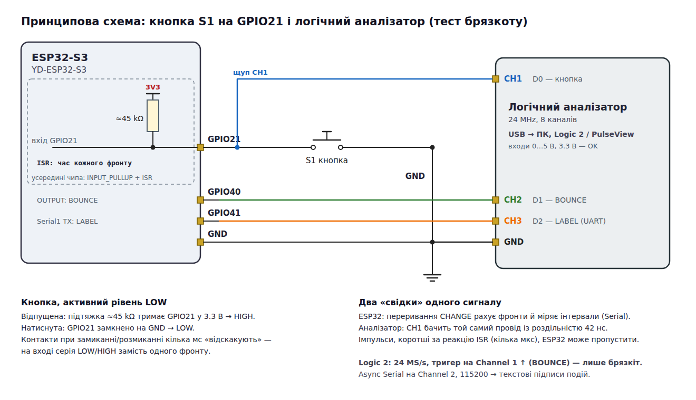
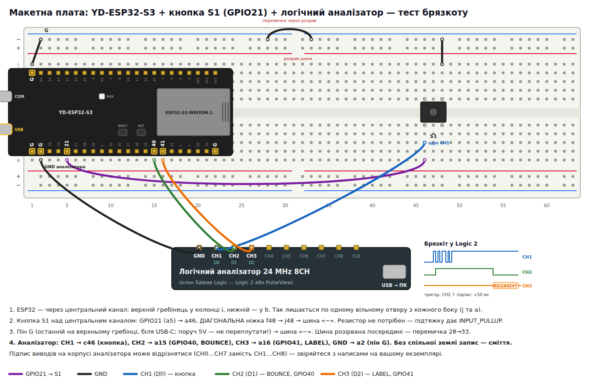

# ESP32-S3: тест брязкоту кнопки з логічним аналізатором

Урок: одна кнопка на GPIO21 і два «свідки» того самого сигналу — **переривання ESP32**, яке
записує час кожного фронту, і **логічний аналізатор** на тому ж проводі. Після кожного натискання
та відпускання в Serial Monitor з'являється звіт, який можна порівняти із записом аналізатора.

Плата — **YD-ESP32-S3** (VCC-GND Studio, клон ESP32-S3-DevKitC-1, N16R8). Кнопка під'єднана так
само, як у [`esp32-s3-led-button`](../esp32-s3-led-button/) (світлодіод тут не потрібен, але й не заважає).

```bash
cd esp32-s3-bounce-test/cpp
pio run -e lab      -t upload && pio device monitor   # звіт на кожну подію + маркери для аналізатора
pio run -e homework -t upload && pio device monitor   # код з умови ДЗ модуля 1.5 (FALLING), пін 16 → 21
```

Та сама прошивка на Rust — у [`rust/`](rust/), див. [розділ 6](#6-rust-версія).

Конспект з анімаціями й справжніми даними цього стенду (190 подій, `docs/bench-11-40.serial.txt`):
**[Брязкіт на стенді](https://grok-rs.github.io/platformio-projects/bounce-bench/)** (локально: `python3 -m http.server -d ../docs` → `/bounce-bench/`).

## 1. Схема



### Монтаж на макетній платі



1. ESP32-S3 через центральний канал: верхній гребінець — у колонку `i`, нижній — у `b`.
2. Кнопка S1 над центральним каналом, ніжки в рядах 46 і 48. GPIO21 (`a5`) → `a46`;
   діагональна ніжка: `j48` → шина «−». Резистор не потрібен — `INPUT_PULLUP`.
3. Пін `G` біля USB-C → шина «−»; шина розірвана посередині — перемичка 28→33.
4. **Логічний аналізатор: CH1 → `c46`** (сигнал кнопки), **GND → `a2`** (пін `G` плати).
5. **Мітки від прошивки** (необов'язково, але з ними брязкіт легко знайти):
   **CH2 → `a15`** (GPIO40, маркер BOUNCE), **CH3 → `a16`** (GPIO41, текстові підписи LABEL).

## 2. Що друкує прошивка

```
=== ESP32-S3: button bounce test ===
Button GPIO21, interrupt CHANGE, event ends after 50 ms of quiet
PRESS   #1   edges=7   bounce=   812 us  shortest=4 us
        gaps us: 210 4 151 9 380 58
RELEASE #1   edges=1   bounce=     0 us  (clean, no bounce)
PRESS   #2   edges=3   bounce=    96 us  shortest=31 us
        gaps us: 31 65
```

(числа — приклад; у кожної кнопки й кожного натискання вони свої)

| Поле | Значення |
|------|----------|
| `PRESS` / `RELEASE` | натискання (рівень став LOW) або відпускання (HIGH) |
| `GLITCH` | фронти були, але рівень повернувся до попереднього — короткий імпульс без натискання |
| `edges` | скільки фронтів побачило переривання. Чиста подія = **1**, усе більше — брязкіт |
| `bounce` | від першого до останнього фронту події, мкс |
| `shortest` | найкоротший інтервал між фронтами — найвужчий «відскок» |
| `gaps us` | інтервали між сусідніми фронтами (перші 10) — порівняйте з курсорами аналізатора |

**Як це працює.** `attachInterrupt(…, CHANGE)` викликає `onButtonEdge()` на кожному фронті; обробник
лише записує `micros()` у масив (він у IRAM і без `Serial` — переривання мають бути короткими).
`loop()` чекає 50 мс тиші, на мить вимикає переривання, забирає масив і друкує звіт.

## 3. Запис у Logic 2

1. Аналізатор — у USB; відкрити **один** екземпляр Logic 2, пристрій з'явиться праворуч угорі.
2. Частота **24 MS/s**, тривалість запису — **кілька секунд**.
3. Тригер на **Channel 0** (CH1 на корпусі): **falling edge** ↓ — запис почнеться з натискання.
4. Start → натиснути кнопку. Наблизити місце фронту: «гребінка» з кількох імпульсів — це брязкіт.
5. Порівняти з рядком `PRESS` у Serial Monitor: кількість фронтів, тривалість, інтервали
   (у Logic 2 — інструмент **Timing Marker**, або навести мишу на імпульс: показує ширину).
6. Потім тригер **rising edge** ↑ — і так само для відпускання.

У PulseView: драйвер **fx2lafw**, 24 МГц, канал **D0**, тригер — значок фронту на D0.

### Мітки: як швидко знайти брязкіт

Брязкіт буває не на кожному натисканні, а триває десятки–сотні мікросекунд — на запису в кілька
секунд його не видно без великого збільшення. Тому прошивка видає ще два сигнали:

| Канал | Пін | Що на ньому |
|-------|-----|-------------|
| CH2 «BOUNCE» (Channel 1) | GPIO40 | HIGH від **другого** фронту події (тобто щойно почався брязкіт) до кінця події |
| CH3 «LABEL» (Channel 2) | GPIO41 | UART 115200: рядок `RELEASE#7 e=4 972us` через ~50 мс після події (`MISSED` — ISR загубила фронт) |

1. **Назви каналів:** клацнути на назву Channel 0/1/2 зліва → `BUTTON`, `BOUNCE`, `LABEL`.
2. **Тригер лише на брязкіт:** тригер на **Channel 1 rising ↑**. Чисті натискання запис не запускають;
   щойно кнопка «відскочить», запис стартує, а сама «гребінка» на Channel 0 — одразу перед точкою 0.
3. **Текстові підписи:** праворуч **Analyzers → + → Async Serial**: Input Channel **2**, Bit Rate **115200**,
   решта за замовчуванням. Над Channel 2 з'являться бульбашки з символами; повний текст — у вкладці
   **Terminal** (значок `>_` праворуч у панелі Analyzers), а в **Data**-таблиці працює пошук: `RELEASE`, `MISSED`.
4. Клацання по рядку в Data-таблиці переносить шкалу до цієї події; брязкіт — ~50 мс лівіше підпису,
   там, де Channel 1 піднявся.

## 4. Що порівнювати й чому числа можуть не збігтися

- **Аналізатор бачить більше фронтів, ніж ESP32.** Переривання стартує за кілька мікросекунд;
  якщо відскок коротший (1–2 мкс), два фронти зливаються в одне переривання. Аналізатор на
  24 MS/s розрізняє імпульси від ~42 нс. Саме тому `shortest` у ESP32 рідко буває < 3–5 мкс.
- **Парність `edges`.** Зміна рівня (HIGH → LOW чи навпаки) — це завжди 1, 3, 5… фронтів, повернення
  до того самого рівня — 0, 2, 4… Якщо парність не сходиться, прошивка дописує
  `[ISR missed >=1 edge - see analyzer]`: імпульс був коротший за реакцію переривання й фронт загубився.
  Подія, після якої рівень не змінився, друкується як `GLITCH` — короткий «стрибок» без натискання.
- **Натискання чи відпускання — що брязкотить більше, залежить від кнопки.** На тестовій кнопці
  (191 подія) натискання брязкотіли в 9 % випадків, а відпускання — у 38 %, до 3.6 мс і 8 фронтів;
  у чверті подій ISR загубила фронт. Тому тригер варто ставити на **обидва** фронти.
- **Різні кнопки — різний брязкіт.** Новенька тактова кнопка дає 0–1 мс, стара чи дешева — до 5–10 мс.
  Звідси типовий програмний антибрязкіт 20–50 мс (як `kDebounceMs = 30` у `esp32-s3-led-button`).

## 5. Завдання

1. Зробіть 10 натискань. Запишіть `edges` і `bounce` для кожного; знайдіть максимум.
2. Для 2–3 натискань знайдіть ту саму подію в аналізаторі: скільки фронтів там?
3. Яке мінімальне значення антибрязкоту безпечне для **вашої** кнопки? Додайте запас ×3–5.
4. Спробуйте іншу кнопку або два шматки дроту замість кнопки — брязкіт буде набагато довшим.

## 6. Rust-версія

[`rust/`](rust/) — та сама прошивка на Rust ([esp-hal](https://docs.espressif.com/projects/rust/) + Embassy),
з тим самим текстом у Serial Monitor і тими самими сигналами BOUNCE/LABEL. Тулчейн і загальні
правила робочого простору — у [кореневому README](../README.md).

```bash
source ~/export-esp.sh                       # раз на термінал: тулчейн Xtensa від espup
cd esp32-s3-bounce-test/rust
cargo run --release                          # bin `lab`: зібрати, прошити, монітор
cargo run --release --bin homework           # код з умови ДЗ (FALLING), пін 21
cargo +stable host-test -p bounce-test       # тести аналізу (src/lib.rs) на ПК, без плати
```

Wokwi: `cargo build --release`, далі в теці `rust/` F1 → *Wokwi: Start Simulator* (`rust/wokwi.toml`).

Логіку відокремлено від заліза: `src/lib.rs` (журнал фронтів `EdgeLog`, класифікація
PRESS/RELEASE/GLITCH, перевірка парності, формат рядків звіту) не знає про GPIO і перевіряється
модульними тестами на ПК, а `src/bin/lab.rs` лише налаштовує виводи, переривання й UART.

| C++ (`cpp/src/main.cpp`) | Rust (`rust/src/bin/lab.rs`) | Чому так |
|---|---|---|
| `volatile uint32_t gEdgeTimes[]`, `gEdgeCount`, `gLastEdgeUs` | `static SHARED: Mutex<RefCell<Option<Shared>>>` з `EdgeLog` | до даних ISR не дістатися без критичної секції — перевіряє компілятор |
| `noInterrupts(); … копіювання … interrupts();` | `critical_section::with(\|cs\| mem::take(&mut s.log))` | секцію неможливо «забути закрити»: вона закінчується разом із замиканням |
| `volatile uint32_t button_counter; button_counter++` (homework) | `static BUTTON_COUNTER: AtomicU32`, `fetch_add(1, Relaxed)` | `volatile` не робить `++` неподільним, атомік — робить |
| `void IRAM_ATTR onButtonEdge()` | `#[handler] #[ram] fn on_button_edge()` | `#[ram]` — код у внутрішній RAM, як `IRAM_ATTR` |
| `attachInterrupt(pin, isr, CHANGE)` | `io.set_interrupt_handler(..)` + `button.listen(Event::AnyEdge)` | один обробник на всі GPIO; прапорець скидає сам обробник (`clear_interrupt()`) |
| `micros()` | `esp_hal::time::Instant::now()` → мкс, обрізані до `u32` | `wrapping_sub` — та сама беззнакова різниця, що й у C++ |
| `Serial1.begin(115200, SERIAL_8N1, -1, 41)` | `UartTx::new(UART1, …).with_tx(GPIO41)` | лише передавач — RX-піна в типі немає взагалі |
| `Serial.printf("%-7s #%-3lu …")` | `impl Display for Report`, `{:<7} #{:<3}` | формат перевіряють тести на ПК |

## Структура

```
cpp/
  platformio.ini      плата YD-ESP32-S3 N16R8
  src/homework.cpp    код з умови ДЗ (лічильник FALLING), BUTTON_IN = 21
  src/main.cpp        ISR CHANGE → час кожного фронту → звіт; маркер BOUNCE (GPIO40), підписи LABEL (GPIO41)
  wokwi.toml          симуляція C++-прошивки (diagram.json — посилання на спільну схему)
rust/
  Cargo.toml          пакет bounce-test: bins `lab` (типовий) і `homework`
  src/lib.rs          аналіз подій без заліза + тести на ПК
  src/bin/lab.rs      ISR на обидва фронти → EdgeLog → звіт; BOUNCE (GPIO40), LABEL (UART1 TX, GPIO41)
  src/bin/homework.rs код з умови ДЗ: FALLING, AtomicU32
  wokwi.toml          симуляція Rust-прошивки
diagram.json          схема Wokwi (кнопка + аналізатор: BUTTON, BOUNCE, LABEL), спільна для обох мов
docs/
  bench-11-40.serial.txt  справжній запис 190 подій з уроку (вивід прошивки lab)
  schematic.png/svg   принципова схема з логічним аналізатором
  breadboard.png/svg  розкладка на макетній платі з аналізатором
  tools/              генератори діаграм (python3 + headless Chrome): tools/render.sh
```
