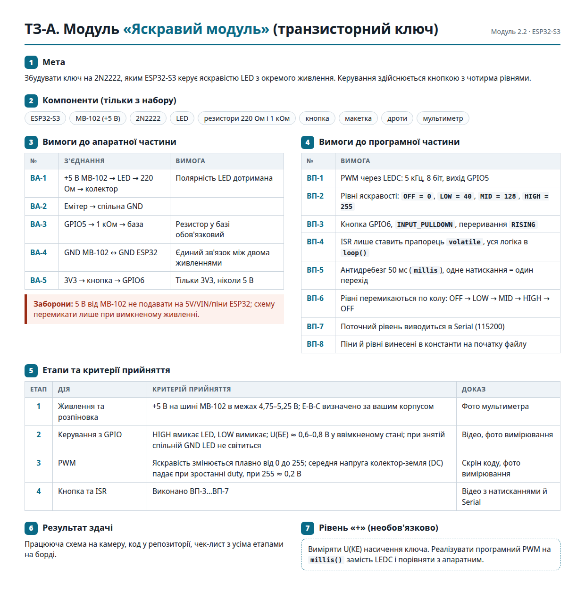
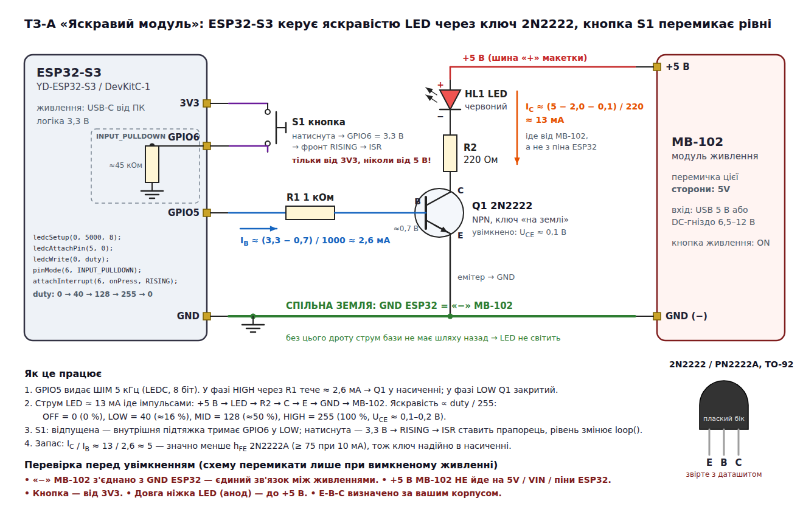
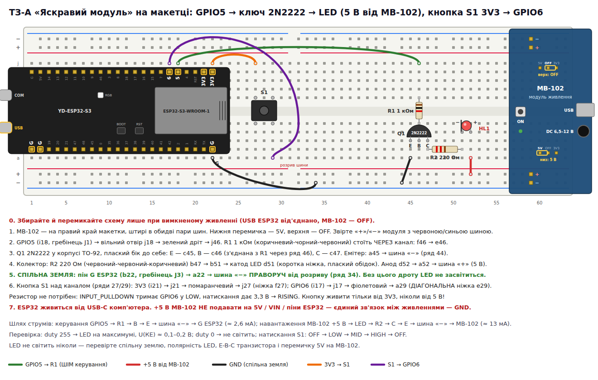
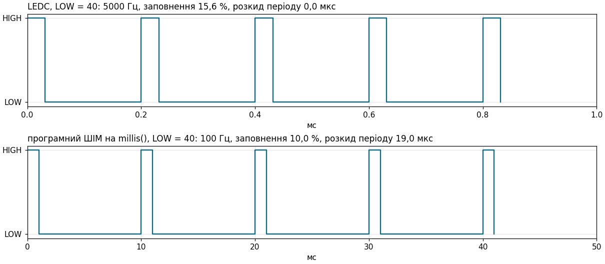

# ESP32-S3: «Яскравий модуль» — ТЗ-A модуля 2.2

Транзисторний ключ на **2N2222**: ESP32-S3 керує яскравістю LED, який живиться не від плати, а від
окремого модуля **MB-102 (+5 В)**. Яскравість задає апаратний ШІМ (LEDC) на **GPIO5**, кнопка на
**GPIO6** перемикає чотири рівні: OFF → LOW → MID → HIGH → OFF.

Плата — **YD-ESP32-S3** (VCC-GND Studio, клон ESP32-S3-DevKitC-1, N16R8). Теорія до заняття —
[«Потужне навантаження»](https://grok-rs.github.io/platformio-projects/power-loads/).

```bash
cd esp32-s3-bright-module/cpp
pio run -e levels  -t upload && pio device monitor   # етап 4: кнопка + 4 рівні (за замовчуванням)
pio run -e switch  -t upload && pio device monitor   # етап 2: GPIO5 HIGH/LOW по 3 с
pio run -e sweep   -t upload && pio device monitor   # етап 3: ШІМ 0 → 255 → 0
pio run -e softpwm -t upload && pio device monitor   # рівень «+»: програмний ШІМ
pio test -e native                                   # модульні тести логіки на ПК, плата не потрібна
```

Та сама прошивка на Rust — у [`rust/`](rust/), див. [розділ 8](#8-rust-версія).



| Вимога ТЗ | Де |
|---|---|
| ВА-1…ВА-5, заборони | [схема й монтаж](#1-схема), [чек-лист](#4-етапи-тз-що-прошивати-й-що-міряти) |
| ВП-1 ШІМ LEDC 5 кГц, 8 біт, GPIO5 | [`lib/board/ledc_output.h`](cpp/lib/board/ledc_output.h), `Config::Pwm` |
| ВП-2 рівні 0 / 40 / 128 / 255 | `Config::Level` у [`include/config.h`](cpp/include/config.h), `DutyTable` у [`brightness.h`](cpp/lib/logic/brightness.h) |
| ВП-3 GPIO6, `INPUT_PULLDOWN`, `RISING` | [`lib/board/button.cpp`](cpp/lib/board/button.cpp) |
| ВП-4 ISR лише ставить `volatile`-прапорець | `Button::onRisingEdge` — один запис у пам'ять |
| ВП-5 антибрязкіт 50 мс, одне натискання = один перехід | [`lib/logic/press_detector.h`](cpp/lib/logic/press_detector.h) — автомат станів, `LevelsApp::handleButton` |
| ВП-6 OFF → LOW → MID → HIGH → OFF | `next()` у [`brightness.h`](cpp/lib/logic/brightness.h) |
| ВП-7 рівень у Serial 115200 | `LevelsApp` у [`src/levels_app.h`](cpp/src/levels_app.h) |
| ВП-8 піни й рівні в константах | [`include/config.h`](cpp/include/config.h) — єдине місце з числами, перевірене `static_assert` (див. [примітки](#10-примітки-до-тз)) |
| Етапи 1–4 | [розділ 4](#4-етапи-тз-що-прошивати-й-що-міряти) — окрема прошивка на кожен етап |
| Рівень «+» | [розділ 5](#5-рівень--програмний-шім-проти-ledc) — `softpwm` і заміри з логічного аналізатора |

## 1. Схема





```
+5 В MB-102 ── LED ── R2 220 Ом ── колектор ┐
                                            2N2222 (NPN, ключ «на землі»)
GPIO5 ── R1 1 кОм ─────────────────── база ┤
                                     емітер ┴── GND ══ GND ESP32 (спільна земля, ВА-4)
3V3 ── кнопка ── GPIO6                      (INPUT_PULLDOWN: відпущена = LOW, натиснута = HIGH)
```

**Розрахунок.** Коли GPIO5 = HIGH (3,3 В), у базу тече I<sub>Б</sub> ≈ (3,3 − 0,7) / 1000 ≈ **2,6 мА** —
пін ESP32-S3 це легко дає. Струм LED іде від MB-102, не з піна: I<sub>К</sub> ≈ (5 − 2,0 − 0,1) / 220 ≈
**13 мА** для червоного LED (білий чи синій, ~3 В, — ≈ 9 мА). Відношення I<sub>К</sub> / I<sub>Б</sub> ≈ 5 значно
менше за h<sub>FE</sub> 2N2222A (≥ 75 при 10 мА), тож транзистор гарантовано в насиченні:
U<sub>КЕ</sub> ≈ 0,1–0,2 В, і майже вся напруга падає на LED і R2.

**Чому саме так з'єднано.**

* R1 обов'язковий (ВА-3): перехід база–емітер — це діод. Без резистора GPIO5 «бачив би» майже коротке
  замикання на GND через 0,7 В переходу.
* Спільна земля (ВА-4): струм бази виходить з GPIO5 і мусить повернутися в ESP32. Шлях назад —
  емітер → GND → GND ESP32. Без цього дроту кола немає, і транзистор не відкривається.
* +5 В MB-102 — лише до LED, ніколи до 5V/VIN/пінів ESP32: два джерела «битимуться» одне з одним.
* Кнопка — від 3V3 (ВА-5): на вхід ESP32-S3 не можна подавати більше 3,3 В.
* ШІМ змінює не напругу, а **частку часу**, коли ключ відкритий: при 5 кГц око бачить середню яскравість.

## 2. Структура коду

```
cpp/
├── platformio.ini        середовища levels, switch, sweep, softpwm (+ *_wokwi) і native
├── include/config.h      struct Config — усі піни, частоти й рівні; static_assert-перевірки
├── lib/logic/            чиста логіка без Arduino.h → тестується на ПК
│   ├── brightness.h      enum class Brightness, next(), name(), DutyTable, dutyPercent()
│   ├── press_detector.h  антибрязкіт: прапорець ISR + рівень → одна подія на натискання
│   ├── sweep.h           заповнення як функція часу: розгін, пауза, спад, пауза
│   └── soft_pwm.h        програмний ШІМ: рівень виводу як функція часу
├── lib/board/            залізо
│   ├── library.json      -Wall -Wextra лише для цієї бібліотеки (не для ядра Arduino)
│   ├── button.h/.cpp     INPUT_PULLDOWN + RISING-переривання, volatile-прапорець
│   ├── ledc_output.h     LEDC для ядра Arduino 2.x і 3.x за одним інтерфейсом
│   ├── soft_pwm_output.h той самий інтерфейс, але ШІМ формує процесор на millis()
│   └── console.h/.cpp    Serial через USB CDC; tryPrintf — друк, що не блокує цикл
├── src/levels_app.h      LevelsApp<Output> — застосунок «4 рівні», спільний для levels і softpwm
├── src/levels.cpp        етап 4: LevelsApp<LedcOutput>
├── src/softpwm.cpp       рівень «+»: LevelsApp<SoftPwmOutput>
├── src/switch.cpp        етап 2
├── src/sweep.cpp         етап 3
└── test/test_logic/      Unity-тести для lib/logic
```

Головний прийом — поділ на **логіку** й **залізо**. `PressDetector`, `Sweep`, `SoftPwm` і `next()` не
викликають `millis()` чи `digitalRead()` самі: час приходить параметром. Тому їх перевіряють тести на
ПК за секунду: брязкіт, коротке «тицяння», утримання з «торохтінням» контакту, голка завади,
переповнення `millis()` через 49 діб, простій циклу, квантування програмного ШІМ.

`levels` і `softpwm` — це один і той самий застосунок `LevelsApp<Output>`, різниться лише вихід.
Шаблон, а не віртуальний клас: тип виходу відомий під час компіляції, виклики вбудовуються, таблиці
віртуальних функцій немає. Порівняння «апаратний vs програмний ШІМ» тому чесне — решта коду однакова.

## 3. Як працює `levels`

```
loop()  ─ десятки тисяч разів на секунду, ніколи не чекає ───────────────────────┐
  nowMs = millis()                         один момент часу на весь прохід       │
  handleButton(nowMs)                                                             │
    edge = button.takeEdge()               прапорець ISR: прочитати й скинути     │
    high = button.isPressed()              рівень входу зараз                     │
    if presses.update(edge, high, nowMs)   автомат: одна подія на натискання      │
         level = next(level)               OFF → LOW → MID → HIGH → OFF           │
         output.write(kDuty[level])        LEDC: одне записування в периферію     │
         tryPrintf("Press #N -> …")        у Serial, не блокуючи цикл             │
  output.update(nowMs)                     LEDC: нічого; програмний ШІМ: HIGH/LOW │
←─────────────────────────────────────────────────────────────────────────────────┘

ISR onRisingEdge()  ─ на кожному зростаючому фронті GPIO6, зокрема на кожному відскоку
  edge_ = true                             і все: без Serial, delay, millis (ВП-4)
```

**Антибрязкіт.** Одне натискання — пачка фронтів за кілька мілісекунд, а брязкіт при *відпусканні*
теж дає зростаючі фронти. Тому ISR лише каже «був фронт», а рішення приймає автомат
[`PressDetector`](cpp/lib/logic/press_detector.h), якому цикл щопроходу подає прапорець, рівень і час:

```
Released ──фронт──▶ Arming ──50 мс минуло, HIGH бачили──▶ Pressed ──LOW і без фронтів 50 мс──▶ Released
                      └──── 50 мс минуло, HIGH не бачили (завада) ────▶ Released
```

* Натискання зараховується через 50 мс після першого фронту, якщо за цей час вхід хоч раз був HIGH.
  Тож навіть коротке «тицяння» (відпустили через 40 мс) не губиться, а одиночна голка завади — ігнорується.
* Повернення до Released — лише після 50 мс безперервного LOW без фронтів: брязкіт відпускання й
  «торохтіння» зношеного контакту під час утримання другого натискання не дають (ВП-5).

Простіший варіант «дочекатися 50 мс тиші й прочитати рівень» має дві дірки: коротке натискання, яке
закінчилось до кінця тиші, губиться (рівень уже LOW), а «торохтіння» під час утримання рахується як нове
натискання. Обидва випадки є в тестах.

**Чому 255 — це 100 %.** 8-бітний таймер LEDC має 256 кроків, тож `ledcWrite(…, 255)` дало б
255/256 = 99,6 % і короткий провал щоперіоду. Ядро Arduino саме підмінює максимум на 256 (повністю
увімкнено), тому на етапі 3 при 255 ключ відкритий постійно й U<sub>КЕ</sub> ≈ 0,2 В. У Rust esp-hal нічого не
підмінює, і це робить `ledc_duty()` у [`lib.rs`](rust/src/lib.rs).

**Що ще зроблено «як для продакшну».**

* Жодних глобальних змінних, `new`/`malloc`, `String`: увесь стан — один статичний об'єкт `app` в
  анонімному просторі імен, навіть прапорець ISR — член `Button` ([`heap-symbols-cpp.txt`](results/heap-symbols-cpp.txt)).
* `Button`, `LedcOutput`, `SoftPwmOutput` не копіюються (`= delete`): ISR тримає вказівник на об'єкт,
  а два власники одного каналу LEDC «смикали» б той самий вивід.
* «Прочитати й скинути прапорець» — у критичній секції `portENTER_CRITICAL`, бо `volatile` не робить
  пару операцій атомарною (секція маскує переривання на ядрі 1, де зареєстровано ISR); швидкий шлях
  без секції, коли фронту не було.
* `tryPrintf` не блокує цикл, якщо монітор не відкритий (USB CDC інакше чекає хоста до 100 мс на рядок).
* Помилка налаштування LEDC не мовчить: `ERROR: PWM output init failed` у Serial.
* `[[nodiscard]]`, `enum class`, `switch` без `default` (+ `-Wswitch`), `PRIu32`, формат `tryPrintf`
  перевіряє компілятор. Збірка — без жодного попередження з `-Wall -Wextra` (`src/` і, через
  [`library.json`](cpp/lib/board/library.json), `lib/board/`); тести — з `-Werror`.

## 4. Етапи ТЗ: що прошивати й що міряти

| Етап | Прошивка | Що робить | Що виміряти / побачити |
|---|---|---|---|
| 1. Живлення й розпіновка | — | — | Мультиметр на шині MB-102: **4,75–5,25 В**. Виводи 2N2222: у режимі «діод» червоний щуп на базу — B→E і B→C по ≈ 0,6–0,7 В (B→C зазвичай трохи менше); на E↔C — обрив в обидва боки. Для пластикових 2N2222A/PN2222A типово **E-B-C** (плаский бік до себе), але звірте з даташитом свого екземпляра |
| 2. Керування з GPIO | `switch` | GPIO5 HIGH 3 с / LOW 3 с, рядок у Serial на кожне перемикання | HIGH → LED світить, **U<sub>БЕ</sub> ≈ 0,6–0,8 В**; LOW → не світить. Перевірка спільної землі: вимкнути живлення, зняти дріт GND, увімкнути — LED не має світитися (див. [примітку 1](#10-примітки-до-тз)) |
| 3. ШІМ | `sweep` | заповнення 0 → 255 за 3,06 с, 3 с на 255, спад, 3 с на 0 | Яскравість плавно росте. Мультиметр DC між колектором і GND: на паузі 255 — **≈ 0,1–0,2 В**; під час розгону — плавно падає; на паузі 0 — кілька вольт (LED без струму, вхід мультиметра 10 МОм) |
| 4. Кнопка й ISR | `levels` | ВП-1…ВП-8 | Відео з натисканнями й Serial: `Press #1 -> LOW (duty 40, 16%)` … |
| Рівень «+» | `switch`, `softpwm` | — | U<sub>КЕ(нас)</sub> на `switch` у фазі HIGH; порівняння ШІМ — [розділ 5](#5-рівень--програмний-шім-проти-ledc) |

Чек-лист перед увімкненням (з ТЗ і [схеми](docs/schematic.png)): «−» MB-102 з'єднано з GND ESP32 — і це
єдиний зв'язок між живленнями; +5 В MB-102 не торкається 5V/VIN/пінів ESP32; кнопка від 3V3; довга
ніжка LED (анод) — до +5 В; E-B-C визначено за вашим корпусом; перемичка MB-102 — на 5V.

Що друкує `levels`:

```
=== Bright module (TZ-A): PWM levels + button ===
PWM GPIO5: LEDC 5000 Hz, 8 bit
Button GPIO6 (INPUT_PULLDOWN, RISING), debounce 50 ms
Level: OFF (duty 0, 0%)
Press #1 -> LOW (duty 40, 16%)
Press #2 -> MID (duty 128, 50%)
Press #3 -> HIGH (duty 255, 100%)
Press #4 -> OFF (duty 0, 0%)
```

## 5. Рівень «+»: програмний ШІМ проти LEDC

`softpwm` — той самий застосунок, але замість LEDC вихід перемикає сам процесор: на кожному проході
циклу `SoftPwm::level(millis(), duty)` вирішує, HIGH чи LOW. Обидві прошивки записано логічним
аналізатором Wokwi на тому самому сценарії й розібрано [`tools/vcd_pwm.py`](tools/vcd_pwm.py):

| | Частота | LOW = 40 | MID = 128 | Розкид періоду | Процесор |
|---|---|---|---|---|---|
| LEDC (`levels`) | 5000,0 Гц | 15,62 % | 50,00 % | 0 мкс | вільний: сигнал генерує периферія |
| `millis()` (`softpwm`) | 100,0 Гц | **≈ 10,0 %** | ≈ 50,0 % | 19–35 мкс | мусить опитувати вихід постійно |

Очікувано: 8-бітний LEDC дає N/256 (40 → 15,63 %, 128 → 50,00 %; лише 255 ядро підмінює на 256/256),
програмний — N/255 × 10 мс, округлене вниз до цілої мілісекунди (40 → 1 мс = 10 %, 128 → 5 мс = 50 %).
Тобто LEDC збігається з розрахунком точно, а програмний ШІМ «губить» LOW через квантування.



Чому так:

* **Квантування.** `millis()` рахує цілими мілісекундами, а період 10 мс. Тож «увімкнено» може тривати
  лише 0, 1, 2 … 10 мс — 11 різних заповнень замість 256. 40/255 × 10 мс = 1,57 мс округлюється до 1 мс:
  LOW стає 10 % замість 15,7 %, а будь-яке заповнення нижче 26 — це повний нуль.
* **Частота.** Щоб мати хоч 10 кроків, період мусить бути 10 мс → 100 Гц. Для 256 кроків знадобився б
  період 256 мс (≈ 4 Гц) — LED помітно блимав би.
* **Тремтіння.** Фронт настає не точно на межі мілісекунди, а на першому проході циклу після неї:
  десятки мікросекунд розкиду. Друк у Serial чи інша робота в `loop()` збільшує його.
* **Ціна.** LEDC після одного запису генерує сигнал сам. Програмний ШІМ живе лише доки цикл крутиться:
  `delay()` будь-де — і LED «завмирає» в HIGH або LOW.

Як покращити програмний варіант: `micros()` замість `millis()` (той самий клас `SoftPwm`, тик = 1 мкс,
період 1000 мкс → 1 кГц і всі 256 рівнів заповнення 0…255) або апаратний таймер з перериванням. Але на ESP32 для цього є
LEDC — вісім каналів, які нічого не коштують процесору.

## 6. Симуляція у Wokwi

[`diagram.json`](diagram.json) — та сама плата на макетці, але з двома відмінностями від справжньої схеми:

1. **Транзистора немає** — у Wokwi їх не буває. LED підключено просто до GPIO5 через 220 Ом, тож
   логіка та сама (HIGH = світить), але струм і напруги ключа тут не перевірити — лише на платі.
2. **Кнопка на GPIO7, а не на GPIO6.** Wokwi тримає GPIO6 ESP32-S3 у HIGH, щойно прошивка налаштовує
   його як вхід — навіть з `INPUT` без підтяжки і з зовнішнім резистором 10 кОм до GND (перевірено:
   на GPIO7 та сама прошивка працює, видно справжній брязкіт). Ймовірно, модель успадкована від ESP32
   без «-S3», де GPIO6…11 — це флеш. На справжній платі GPIO6 вільний. Тому для симулятора є окремі
   збірки: `pio run -e levels_wokwi` / `softpwm_wokwi` (прапорець `-DWOKWI`) і
   `cargo build --release --features wokwi`. `switch` і `sweep` кнопки не мають — вони однакові.

```bash
cd esp32-s3-bright-module
(cd cpp && pio run -e levels_wokwi -e softpwm_wokwi -e switch -e sweep)
wokwi-cli cpp --scenario ../wokwi/scenarios/levels.yaml --timeout 30000
wokwi-cli cpp --elf cpp/.pio/build/softpwm_wokwi/firmware.elf --scenario ../wokwi/scenarios/levels.yaml --timeout 30000
wokwi-cli cpp --elf cpp/.pio/build/switch/firmware.elf --scenario ../wokwi/scenarios/switch.yaml --timeout 15000
wokwi-cli cpp --elf cpp/.pio/build/sweep/firmware.elf  --scenario ../wokwi/scenarios/sweep.yaml  --timeout 25000
# з --vcd-file levels.vcd — запис логічного аналізатора для tools/vcd_pwm.py
```

Сценарії: [`levels.yaml`](wokwi/scenarios/levels.yaml) — повне коло з чотирьох натискань, рівень GPIO5
на OFF (постійно 0) і HIGH (постійно 1), утримання 1,5 с і брязкіт відпускання не дають зайвих
переходів; [`switch.yaml`](wokwi/scenarios/switch.yaml) — HIGH/LOW по 3 с;
[`sweep.yaml`](wokwi/scenarios/sweep.yaml) — постійний HIGH на паузі 255 і LOW на паузі 0.

## 7. Результати

| Що | Результат | Файл |
|---|---|---|
| Модульні тести C++ (`pio test -e native`, `-Werror`) | 16/16 | [`native-tests-cpp.txt`](results/native-tests-cpp.txt) |
| Модульні тести Rust (`cargo +stable host-test`) | 17/17 | [`host-tests-rust.txt`](results/host-tests-rust.txt) |
| Wokwi `levels.yaml` на `levels` і `softpwm` | пройшли (C++ і Rust) | [`wokwi-cpp-levels.serial.txt`](results/wokwi-cpp-levels.serial.txt), [`wokwi-rust-levels.serial.txt`](results/wokwi-rust-levels.serial.txt), `…-softpwm.serial.txt` |
| Wokwi `switch.yaml`, `sweep.yaml` | пройшли (C++ і Rust) | `wokwi-{cpp,rust}-{switch,sweep}.serial.txt` |
| LEDC проти програмного ШІМ | таблиця вище | [`pwm-compare-cpp.txt`](results/pwm-compare-cpp.txt), [`pwm-compare-rust.txt`](results/pwm-compare-rust.txt) |
| Купа | у наших об'єктних файлах немає `malloc`/`new`/`free` | [`heap-symbols-cpp.txt`](results/heap-symbols-cpp.txt) |
| Розмір (`pio run`) | levels: RAM 19,6 КБ, Flash 274 КБ | [`build-size-cpp.txt`](results/build-size-cpp.txt) |
| Попередження компілятора | 0 (C++ `-Wall -Wextra` для `src/` і `lib/board/`, Rust clippy з лінтами робочого простору) | — |

Текст у Serial у C++ і Rust однаковий (Arduino `println` закінчує рядок `\r\n`, Rust — `\n`), тому
одні й ті самі сценарії перевіряють обидві мови.

## 8. Rust-версія

[`rust/`](rust/) — те саме на `esp-hal` 1.x: та сама логіка, той самий текст у Serial, ті самі сценарії
Wokwi. Embassy свідомо немає: як і в C++, це superloop з кнопкою на перериванні.

```bash
cd esp32-s3-bright-module/rust
cargo run --release                   # levels
cargo run --release --bin switch      # етап 2  (sweep — етап 3, softpwm — рівень «+»)
cargo +stable host-test -p bright-module
```

| C++ | Rust |
|---|---|
| `LevelsApp<Output>` — шаблон; вимоги до `Output` неявні | `run_levels(impl DutyOutput, …)` — трейт `DutyOutput`; вимоги перевіряє компілятор |
| `struct Config { static constexpr … }` + `static_assert` після структури | `mod config { pub const … }` + `const _: () = assert!(…)` поруч |
| `#ifdef WOKWI` для піна кнопки | `#[cfg(feature = "wokwi")]` у макросі `button_pin!` — пін тут тип (`GPIO6`/`GPIO7`), тож і заміна на рівні типів |
| пін = константа з `Config`: `pinMode(Config::Pwm::kPin, …)` | пін — тип, а константа лише число: `checked_pin(peripherals.GPIO5, config::pwm::PIN)` на старті перевіряє, що вони не розійшлися |
| `ledcSetup` / `ledcAttachPin` / `ledcWrite(канал, …)`; 255 → 256 робить ядро; тактування — кварц 40 МГц | `Ledc` → `timer.configure(…)` → `channel.configure(…)` → `SetDutyCycle`; 255 → 256 робить `ledc_duty()`; тактування — APB 80 МГц. Частота однакова: 5000,0 Гц |
| помилка LEDC → `ERROR: …` у Serial, робота триває | `expect(…)`: параметри — константи, вже перевірені під час компіляції; помилка тут — баг, panic з повідомленням |
| `INPUT_PULLDOWN`, `attachInterruptArg(…, RISING)` | `Pull::Down`, `Io::set_interrupt_handler` + `listen(Event::RisingEdge)` |
| `volatile bool` + `portENTER_CRITICAL` для «прочитати й скинути» | `static AtomicBool` + `swap(false)` — одна неподільна операція; обробник один на всі GPIO, тож перевіряє `is_interrupt_set()` |
| `beginConsole` чекає монітор до 2 с, щоб банер не загубився | не чекає: якщо монітор відкрили пізніше, банер на платі може загубитися (у Wokwi — ні); рядки `Press #…` друкуються як завжди |
| канал LEDC — член `LedcOutput` | канал позичає таймер (`Channel<'a>` з `&'a Timer`), тож таймер живе в `main`: це правило позичання, а не стиль |
| `enum class Brightness` + `name()` | `enum Brightness` + `impl Display` |
| `pio test -e native` (Unity) | `cargo +stable host-test` (`#[test]`) |

## 9. Схеми

[`docs/schematic.svg`](docs/schematic.svg) і [`docs/breadboard.svg`](docs/breadboard.svg) згенеровані
скриптами з [`docs/tools/`](docs/tools/) (`render.sh` — SVG → PNG через headless Chrome і копія на
сторінку курсу). Макетка — та сама модель YD-ESP32-S3, що й у
[`esp32-s3-bounce-test`](../esp32-s3-bounce-test/docs/tools/yd_board.py).

## 10. Примітки до ТЗ

1. **Тест «зняти спільну GND — LED гасне» (етап 2) може не спрацювати.** Якщо MB-102 живиться від USB
   того самого комп'ютера, що й ESP32, їхні «мінуси» вже з'єднані через комп'ютер, і LED світитиме
   й без дроту. Для чесного тесту MB-102 живлять від окремого адаптера чи батареї.
2. **Етап 2 і заборона «перемикати лише при вимкненому живленні».** Дріт GND знімають при вимкненому
   живленні, а потім вмикають — тоді обидві вимоги виконано.
3. **ВП-8 «константи на початку файлу».** Тут усі піни й рівні — в одному файлі
   [`include/config.h`](cpp/include/config.h), який першим підключають усі чотири прошивки, і там же їх
   перевіряє компілятор. Якщо викладач вимагає буквально «на початку `main`-файлу» — `struct Config`
   можна перенести на початок `levels.cpp` без інших змін.
4. **API LEDC.** Проєкт зібрано з ядром Arduino-ESP32 2.0.17 (`platform espressif32@^7`), де LEDC —
   це `ledcSetup` + `ledcAttachPin` + `ledcWrite(канал, …)`. В ядрі 3.x — `ledcAttach(пін, Гц, біт)` і
   `ledcWrite(пін, …)`. [`LedcOutput`](cpp/lib/board/ledc_output.h) підтримує обидва.
5. **Термін.** «Антидребезг» — калька з російської; українською — **усунення брязкоту** (антибрязкіт).
6. **Яскравість не лінійна.** Око сприймає яскравість приблизно логарифмічно, тож LOW = 16 % виглядає
   значно яскравішим за «шосту частину», а різниця між MID і HIGH — малою. Для рівномірних кроків
   застосовують гамма-корекцію (наприклад, 0 / 10 / 60 / 255) — гарне питання для обговорення.
