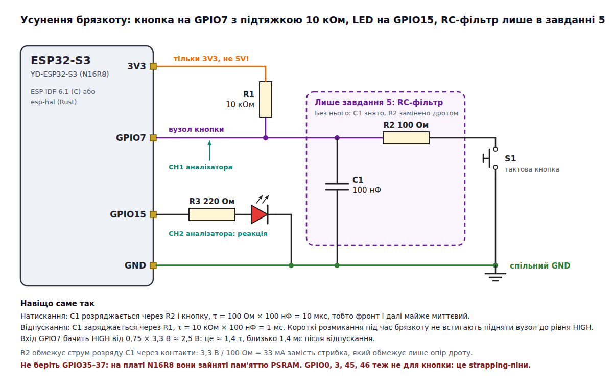
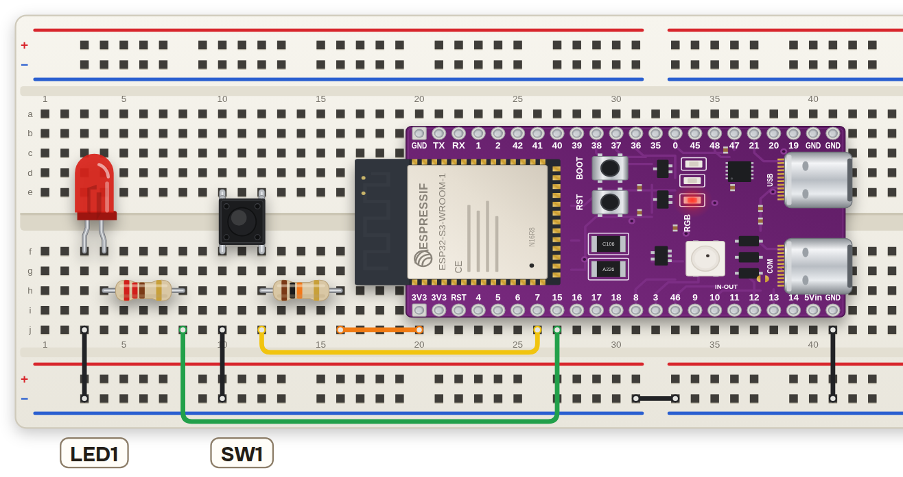
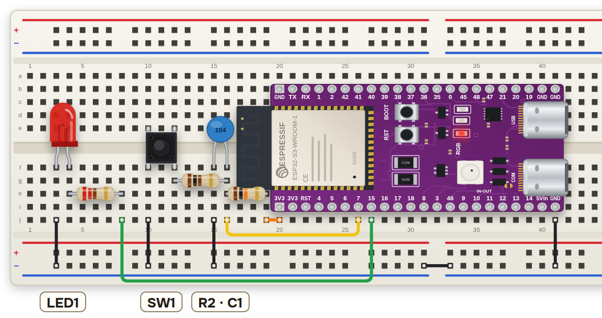
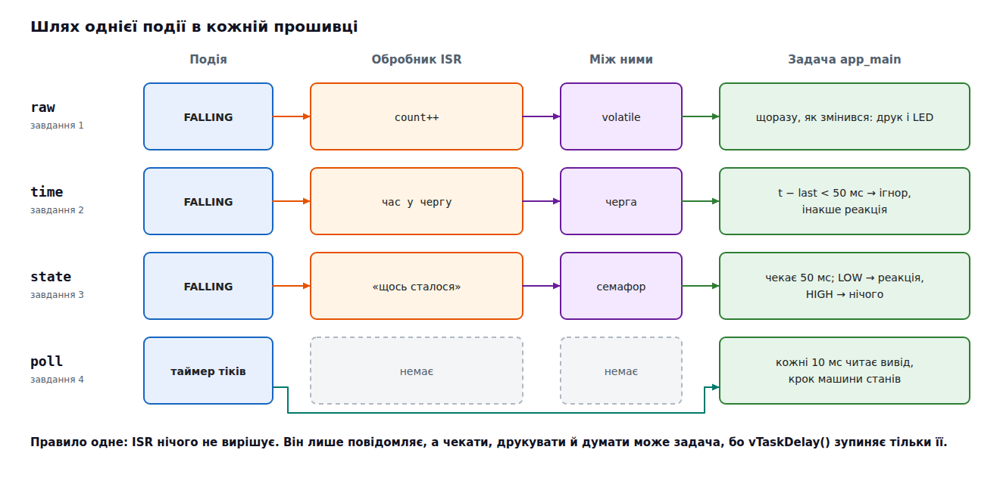
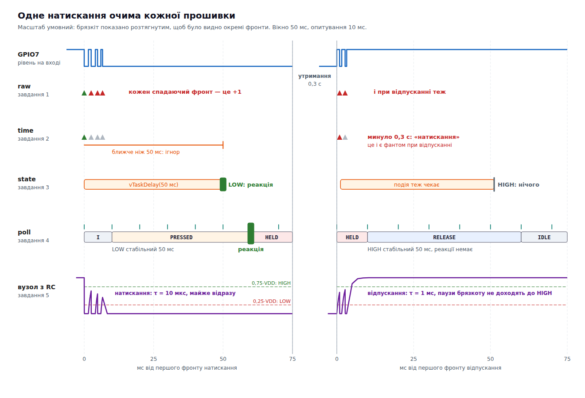
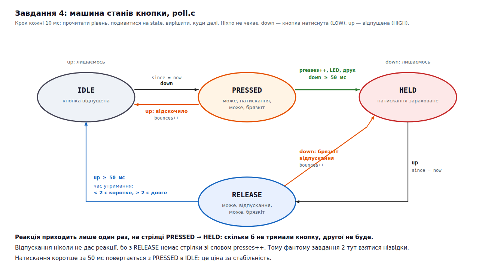
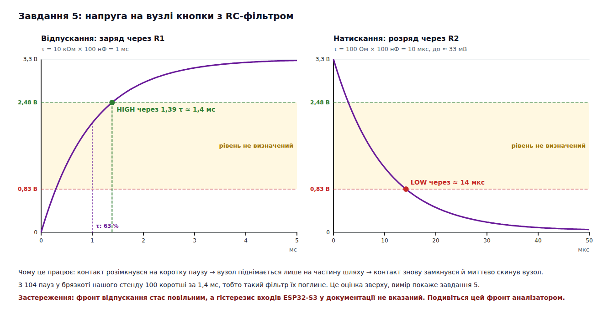

# ESP32-S3: усунення брязкоту на ESP-IDF — ДЗ модулів 2.4 і 2.6

Домашнє завдання 2.6 просить зробити завдання уроку 2.4 на ESP-IDF. ДЗ 2.4 дозволяє Arduino або ESP-IDF, тож цей
проєкт закриває обидва. Одна коротка прошивка на завдання:

| Завдання | Прошивка | Що робить |
|---|---|---|
| 1. Базова реалізація | `cpp/src/raw.c` · `rust/src/bin/raw.rs` | переривання FALLING лише рахує |
| 2. Time-based | `cpp/src/time.c` · `rust/src/bin/time.rs` | ISR кладе час у чергу, задача відкидає все, що ближче за 50 мс |
| 3. State-based | `cpp/src/state.c` · `rust/src/bin/state.rs` | ISR лише сигналізує, задача через 50 мс перевіряє рівень |
| 4. Polling | `cpp/src/poll.c` · `rust/src/bin/poll.rs` | без переривань: опитування кожні 10 мс і машина станів |
| 5. Hardware RC | ті самі чотири | змінюється лише схема |
| 6. Таблиця | [нижче](#завдання-6-порівняльна-таблиця) | заповнюється вимірами |

```bash
cd esp32-s3-debounce-idf/cpp
pio run -e raw   -t upload && pio device monitor     # завдання 1 (за замовчуванням)
pio run -e time  -t upload && pio device monitor     # завдання 2
pio run -e state -t upload && pio device monitor     # завдання 3
pio run -e poll  -t upload && pio device monitor     # завдання 4

cd esp32-s3-debounce-idf/rust && source ~/export-esp.sh
cargo run --release                                  # raw; --bin time / state / poll
```

Перше збирання завантажує ESP-IDF 6.1 з тулчейном, це кілька хвилин.
У теці `cpp/` тут C, а не C++: ESP-IDF пишеться на C, а прошивка без класів. Rust-варіант теж на ESP-IDF і FreeRTOS
([esp-idf-hal](https://github.com/esp-rs/esp-idf-hal), `std`): ті самі черга, семафор і `xTaskDelayUntil`, див.
[C ↔ Rust](#c--rust). Його перше `cargo build` завантажує й збирає ESP-IDF 5.5 у `rust/.embuild/`, це надовго.

Теорія: [урок 2.6 на сайті](https://grok-rs.github.io/platformio-projects/lessons/2-6/).

> **Статус.** Усі чотири прошивки зібрані на C (ESP-IDF 6.1.0) і Rust (esp-idf-hal, ESP-IDF 5.5.5). Rust-версії
> пройшли стенд 15.11.2026 без RC і з RC: логи в [`results/`](results/), числа в таблиці завдання 6. C-версії на платі
> запускалися лише як перевірка (`raw`). Логіку C-файлів перевірено симуляцією на ПК на записаних фронтах стенду
> ([`results/replay-on-pc.txt`](results/replay-on-pc.txt)). Симуляція дала стовпчик «Очікування»,
> а виміри стенду — решту таблиці.

## Деталі

| Позначення | Деталь | Шт. | Для чого |
|---|---|---|---|
| — | YD-ESP32-S3 (N16R8), кабель USB-C, макетка | 1 | керування |
| S1 | тактова кнопка | 1 | об'єкт дослідження |
| R1 | резистор 10 кОм | 1 | незмінна підтяжка до 3V3 |
| R3 | резистор 220 Ом | 1 | LED |
| HL1 | LED червоний | 1 | реакція прошивки |
| R2, C1 | резистор 100 Ом, конденсатор 100 нФ (104) | по 1 | лише завдання 5 |
| — | логічний аналізатор (необов'язково) | 1 | CH1 на GPIO7, CH2 на GPIO15, GND на GND |

## Схема



```
3V3 ── R1 10 кОм ──┬── GPIO7              кнопка на GND, підтяжка зовнішня
                   ├── S1 ── GND          завдання 1–4
                   │
                   ├── C1 100 нФ ── GND   завдання 5: C1 додано,
                   └── R2 100 Ом ── S1 ── GND   R2 між вузлом і кнопкою
GPIO15 ── R3 220 Ом ── LED ── GND         перемикається на кожну реакцію
```

Підтяжка 10 кОм **незмінна**, як і просить завдання, тому внутрішню вимкнено. GPIO7 — звичайний вивід; GPIO35 із
тексту уроку на N16R8 зайнятий PSRAM.

## Макетка

Завдання 1–4:



| № | Звідки | Куди | Дріт на малюнку |
|---|---|---|---|
| 1 | GND плати (стовпчик 41) | шина «−», розрив шини закрити перемичкою | чорний |
| 2 | 3V3 (j20) | j16 | помаранчевий |
| 3 | R1 10 кОм | h16 → h12 | — |
| 4 | GPIO7 (j26) | j12 | жовтий |
| 5 | S1 | через канавку, ніжки в стовпчиках 10 і 12 | — |
| 6 | стовпчик 10 | шина «−» | чорний |
| 7 | GPIO15 (j27) | j8, уздовж нижнього краю | зелений |
| 8 | R3 220 Ом | h8 → h4 | — |
| 9 | LED | анод у стовпчику 4, катод у 3 | — |
| 10 | стовпчик 3 | шина «−» | чорний |

Завдання 5, змінюється лише вузол кнопки:



| № | Що зробити | Куди |
|---|---|---|
| 1 | переставити R1 10 кОм | h16 → h19 |
| 2 | переставити помаранчевий дріт | j19 → 3V3 (j20) |
| 3 | переставити жовтий дріт від GPIO7 | у j16: це тепер вузол кнопки |
| 4 | додати R2 100 Ом | g12 → g16 |
| 5 | додати C1 100 нФ (104) | f15, f16 |
| 6 | додати чорний дріт | стовпчик 15 → шина «−» |

Перевірте мультиметром: на GPIO7 при відпущеній кнопці ≈ 3,3 В, при натиснутій ≈ 0 В. З R2 при натиснутій буде
≈ 33 мВ, це нормально.

## Що в кожній прошивці





**Завдання 1.** `count++` в обробнику, друк у `app_main`. Одне натискання дає кілька переривань, а брязкіт
відпускання теж має спадаючі фронти. LED перемикається на кожне переривання, тож парна кількість фронтів виглядає
як «кнопка не спрацювала».

**Завдання 2.** Рішення приймає задача, а не ISR, як і вимагає завдання:

```c
bool ok = t - last >= DEBOUNCE_US;
last = t;  // рахуємо від попереднього переривання, не від прийнятого
```

Час рахується від попереднього переривання, тому пачка фронтів не проб'є фільтр, навіть якщо вона довша за 50 мс.
Але фронт відпускання приходить через сотні мілісекунд після натискання: для часу це нова подія.

**Завдання 3.** Час не дивиться на причину, а рівень дивиться. Через 50 мс після події `HIGH` означає, що це було
відпускання. `vTaskDelay()` тут зупиняє лише цю задачу. Натискання, коротше за 50 мс, буде відкинуте: це ціна.

**Завдання 4.** Машина станів з уроку: `IDLE → PRESSED → HELD → RELEASE → IDLE`. Переривань немає зовсім;
`vTaskDelayUntil()` тримає рівний крок 10 мс. Відскок у `PRESSED` чи `RELEASE` повертає на крок назад і перезапускає
відлік. На виході ще й коротке (менше 2 с) чи довге натискання.



**Завдання 5.** Прошивки ті самі, міняється залізо. Натискання: C1 розряджається через R2, τ = 100 Ом × 100 нФ =
10 мкс. Відпускання: C1 заряджається через R1, τ = 10 кОм × 100 нФ = 1 мс, а рівень HIGH (0,75·VDD) настає через
≈ 1,4 τ. Короткі розмикання під час брязкоту не встигають підняти вузол. Перевірте аналізатором і таке: фронт
відпускання стає повільним, а гістерезис входів ESP32-S3 у документації не вказаний, тож на FALLING може прийти
зайвий фронт саме на повільному переході.



## ESP-IDF після Arduino

| | ESP-IDF | Arduino |
|---|---|---|
| Вхід | `app_main()` без `setup()/loop()` | `setup()` + `loop()` |
| Вивід | `gpio_config()` одразу на маску пінів | `pinMode()` |
| Переривання | `gpio_install_isr_service(0)` + `gpio_isr_handler_add()` | `attachInterrupt()` |
| Час | `esp_timer_get_time()`, 64 біти, мкс | `micros()`, 32 біти |
| Очікування | `vTaskDelay(pdMS_TO_TICKS(мс))` | `delay(мс)` |
| Лог | `printf()` | `Serial.printf()` |

Дві пастки: стандартний тік FreeRTOS у ESP-IDF — 10 мс, а `pdMS_TO_TICKS(5)` за такого тіку дорівнює нулю. Тому
`cpp/sdkconfig.defaults` ставить 1000 Гц, як в Arduino. Там само консоль перенесено на нативний USB, бо стандартно
лог іде в UART0.

## Завдання 6: порівняльна таблиця

Спосіб вимірювання, однаковий для всіх рядків: 20 спокійних натискань, кожне довше за 0,3 с, плюс 5 довгих по 1–2 с.
«Хибні» = прийнято мінус справжні натискання, числа беріть із Serial. «Затримку» теж друкує прошивка; у завданнях 3–4
вона рахується від першої події. Точніше покаже аналізатор: CH1 на GPIO7, CH2 на GPIO15. Стовпчик «Очікування» — це
розрахунок і прогноз за нашими записаними фронтами, а не результат.

| Метод | Очікування (хибних) | Кількість хибних спрацювань | Затримка | Складність | Коментар |
|---|---|---|---|---|---|
| Без debounce | багато: ≈ 156–162 переривання на 91 натискання | 12 на 10 натискань (22 переривання), [лог](results/serial-raw.txt) | 0: реагує на перший фронт | найпростіше | кожне натискання в середньому дає 2,2 переривання; LED іноді «не реагує» — парна кількість перемикань |
| Time-based | менше: 134 реакції на 91 натискання | 3 на 10 натискань (13 прийнято, 7 фронтів відкинуто), [лог](results/serial-time.txt) | ≈ 15 мкс від переривання до LED | черга ISR → задача, один поріг | брязкіт натискання фільтрує, але фронт через > 50 мс (відпускання, удар) проходить як нове натискання |
| State-based | 0: 91 реакція на 91 натискання | 0 на 10 натискань (22 переривання, 10 реакцій), [лог](results/serial-state.txt) | ≈ 49,5 мс: чекаємо 50 мс перед перевіркою | семафор ISR → задача, перевірка рівня, очікування відпускання | рівно 1 реакція на натискання; ціна — затримка й відкинуте натискання, коротше за 50 мс |
| Polling | 0: 91 реакція на 91 натискання | 0 на 10 натискань, 0 відскоків, [лог](results/serial-poll.txt) | 50 мс (5 кроків по 10 мс) | машина станів на 4 стани, без переривань | найстабільніше: брязкіт коротший за крок 10 мс опитування просто не бачить; ще й розрізняє коротке/довге |
| Hardware RC | значно менше: 100 із 104 пауз коротші за поріг | `raw`: 122 на 10 натискань (132 переривання), [лог](results/serial-raw-rc.txt); `time`: 10 на 10 (20 прийнято, 106 відкинуто), [лог](results/serial-time-rc.txt); `state`: 0 на 10 (125 переривань), [лог](results/serial-state-rc.txt); `poll`: 0 на 12, довгі натискання розпізнано, [лог](results/serial-poll-rc.txt) | натискання миттєве (τ = 10 мкс), відпускання повільне (τ = 1 мс) | +2 деталі, код той самий | натискання стало чистим (+1), але повільний фронт відпускання дає 8–16 хибних FALLING: вхід без гістерезису «тремтить» біля порогу |

**Висновок за вимірами 15.11.2026.** Кнопка брязкотить на більшості натискань: без фільтра 10 натискань дали 22
переривання. Фільтр за часом ловить брязкіт натискання, але не відрізняє фронт відпускання від нового натискання.
Перевірка рівня й опитування дають рівно одну реакцію на натискання ціною ≈ 50 мс затримки, а опитування ще й не
потребує переривань і розрізняє коротке й довге натискання. RC-фільтр очистив натискання, але зробив відпускання
повільним, і вхід ESP32-S3 без гістерезису на ньому «тремтить»: методи, що рахують фронти (`raw`, `time`), стали гіршими,
а методи, що дивляться на стабільний рівень (`state`, `poll`), не помітили різниці. Апаратному фільтру потрібен
тригер Шмітта (наприклад, 74HC14) або програмна перевірка рівня після нього.

Прогноз узято з [190 подій стенду](https://grok-rs.github.io/platformio-projects/bounce-bench/) (кнопка на GPIO21, без
RC): через `raw.c`, `time.c`, `state.c` і `poll.c` на ПК прогнали записані фронти, натискання тримали 200 мс. Зайві 43
реакції `time.c` — це 35 відпускань і 8 імпульсів під час утримання. Частина фронтів у записі пропущена, тож числа
орієнтовні, а ваша кнопка може поводитися інакше: саме для цього таблиця й потрібна.

Симуляція на ПК (`docs/tools/host_replay/run.sh`) проганяє справжні `.c` через такі сценарії:

| Сценарій | `raw` | `time` | `state` | `poll` |
|---|---|---|---|---|
| 5 чистих натискань | 5 | 5 | 5 | 5 |
| 5 натискань із брязкотом в обидва боки | 25 | 10 | 5 | 5 |
| 3 натискання по 30 мс, коротші за вікно | 3 | 3 | 0 | 0 |
| 91 натискання зі стенду | ≈162 | 134 | 91 | 91 |

Як заповнити таблицю вище: `raw`, `time`, `state`, `poll` по черзі без RC, потім те саме з RC. У рядок Hardware RC
запишіть найгірший із чотирьох або зробіть окремий рядок на кожну прошивку.

## Що здати в LMS

1. Прошийте всі чотири прошивки, збережіть логи: `pio device monitor -f log2file`. Покладіть їх у
   `results/serial-raw.txt`, `serial-time.txt`, `serial-state.txt`, `serial-poll.txt`, а з RC додайте `-rc` до назви.
2. Заповніть таблицю завдання 6 і стовпчик висновків.
3. Запуште репозиторій і вставте в обидва домашні завдання, 2.4 і 2.6, посилання та текст:

```
Код і результат: https://github.com/grok-rs/platformio-projects/tree/main/esp32-s3-debounce-idf
Завдання 2.4 на ESP-IDF 6.1: raw (переривання), time (фільтр часу в задачі), state (перевірка рівня),
poll (опитування кожні 10 мс + машина станів), RC 100 Ом + 100 нФ. Порівняльна таблиця в README.
```

Перемалювати діаграми: `docs/tools/render.sh`, макетки: `docs/tools/export_breadboard.sh`.

## C ↔ Rust

Обидві версії на ESP-IDF і FreeRTOS і друкують однаковий текст. C викликає ESP-IDF напряму, Rust — через
esp-idf-hal, а де обгортки бракує, через ті самі C-функції з `esp_idf_svc::sys`.

| | C (ESP-IDF 6.1) | Rust (esp-idf-hal, ESP-IDF 5.5) |
|---|---|---|
| Виводи | `gpio_config_t` | `PinDriver::input(…, Pull::Floating)`, `PinDriver::output(…)` |
| Переривання | `gpio_install_isr_service()` + `gpio_isr_handler_add()` | ті самі виклики через `esp_idf_svc::sys` |
| Обробник | `static void IRAM_ATTR on_fall(void*)` | `unsafe extern "C" fn on_fall(*mut c_void)` |
| ISR → задача | `xQueueSendFromISR`, двійковий семафор | `Queue<i64>`, `Queue<()>` на 1 елемент — той самий семафор; `send_back` сам бачить, що він в ISR |
| Пробудити задачу з ISR | `portYIELD_FROM_ISR()` | `do_yield()` |
| Очікування | `vTaskDelay()` | `FreeRtos::delay_ms()` — теж чекає лише задача |
| Рівний крок опитування | `vTaskDelayUntil()` | `xTaskDelayUntil()` з `sys` |
| Машина станів | `enum` + `switch` | `enum` + `match` з умовами, забутий стан не скомпілюється |

**Чому не `PinDriver::subscribe()`.** Обробник esp-idf-hal першим ділом вимикає переривання виводу, а вмикати його
знову можна лише із задачі. Для кнопки «увімкнути зараз» це не біда, але тут ми досліджуємо брязкіт: усі фронти
між спрацюванням і повторним увімкненням загубилися б, і завдання 1 показало б «чисту» кнопку. Тому обробник
підключено так само, як у C.

Rust-проєкт — окремий робочий простір Cargo (решта репозиторію на esp-hal без ОС). Потрібні тулчейн `esp`
(`espup install`), `source ~/export-esp.sh` і `cargo install ldproxy`.
