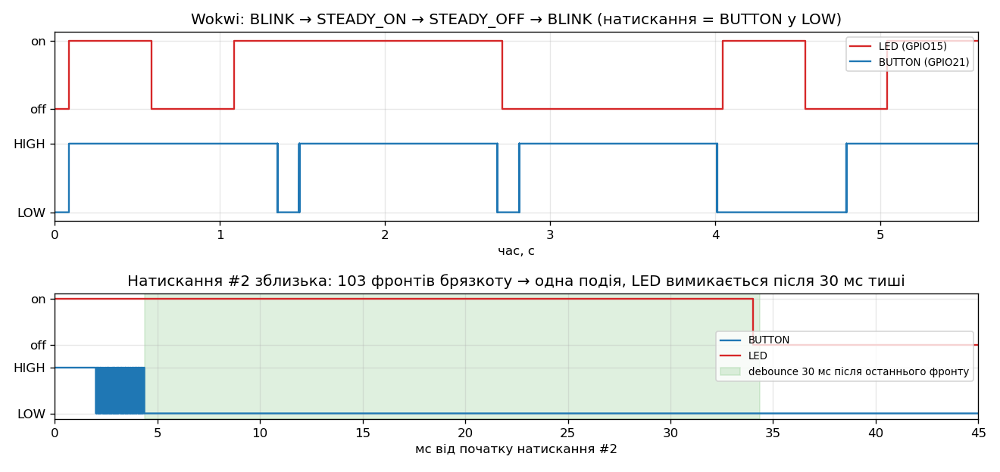

# ESP32-S3: Embedded C++ — ДЗ модуля 2.1

Домашнє завдання «Embedded C++ на ESP32»: класичний Arduino Blink, переписаний за правилами
вбудованого C++, — без `delay()`, без магічних чисел, без купи. Далі — заміри superloop і кнопка
на перериванні, що перемикає режими LED.

Плата — **YD-ESP32-S3** (VCC-GND Studio, клон ESP32-S3-DevKitC-1, N16R8). Стенд той самий, що в
[`esp32-s3-led-button`](../esp32-s3-led-button/): **LED на GPIO15** (через 220 Ω), **кнопка на GPIO21** → GND.

```bash
cd esp32-s3-embedded-cpp/cpp
pio run -e modes -t upload && pio device monitor   # завдання 1–4 (за замовчуванням)
pio run -e blink -t upload && pio device monitor   # завдання 1–2: лише неблокуючий blink
pio test -e native                                 # модульні тести логіки на ПК, плата не потрібна
```

Та сама прошивка на Rust — у [`rust/`](rust/), див. [розділ 7](#7-rust-версія).

| Завдання | Де в коді |
|---|---|
| 1. `enum class` для стану LED | [`lib/logic/led_state.h`](cpp/lib/logic/led_state.h) — `enum class LedState : uint8_t { Off, On }` |
| 1. `constexpr` пін та інтервал | [`include/config.h`](cpp/include/config.h) — `Config::Led::kPin`, `kBlinkIntervalMs` |
| 1. Без глобальних змінних | по одному об'єкту `app` в анонімному просторі імен ([`blink.cpp`](cpp/src/blink.cpp), [`modes.cpp`](cpp/src/modes.cpp)); навіть прапорець ISR — член `Button` |
| 1. Без `delay()`, `millis()` у superloop | [`lib/logic/blinker.h`](cpp/lib/logic/blinker.h) — `Blinker::update(nowMs)` |
| 1. Клас `Led` з `init()` і `set(LedState)` | [`lib/board/led.h`](cpp/lib/board/led.h) |
| 2. Структура зі `static constexpr`, без магічних чисел | [`include/config.h`](cpp/include/config.h) — `struct Config` + `static_assert` |
| 3. Час ітерації `loop()`, звіт кожні 1000 ітерацій | [`lib/logic/loop_stats.h`](cpp/lib/logic/loop_stats.h), `ModesApp::profile()` у [`modes.cpp`](cpp/src/modes.cpp) |
| 4. Кнопка на `attachInterrupt`, `volatile bool`, мінімальний ISR | [`lib/board/button.h`](cpp/lib/board/button.h), [`button.cpp`](cpp/lib/board/button.cpp) |
| 4. Режими й антибрязкіт у `loop()` | [`lib/logic/debouncer.h`](cpp/lib/logic/debouncer.h), `ModesApp::handleButton()` |

Результати запусків — у [`results/`](results/) (див. [розділ 6](#6-результати)).

## 1. Схема

Та сама, що в [`esp32-s3-led-button`](../esp32-s3-led-button/#2-схема) (там же компоненти й [монтаж на макетній платі](../esp32-s3-led-button/#3-монтаж-на-макетній-платі)):


```
GPIO15 ── 220 Ω ── анод LED ── катод ── GND
GPIO21 ── кнопка ── GND        (INPUT_PULLUP: відпущена = HIGH, натиснута = LOW)
```

## 2. Структура коду

```
cpp/
├── platformio.ini       середовища modes, blink (ESP32-S3) і native (тести на ПК)
├── include/config.h     struct Config — усі константи проєкту
├── lib/logic/           чиста логіка без Arduino.h → тестується на ПК
│   ├── led_state.h      enum class LedState, LedMode; nextMode(), modeName()
│   ├── blinker.h        неблокуюче блимання на millis()
│   ├── debouncer.h      антибрязкіт для кнопки на перериванні
│   └── loop_stats.h     min / max / середнє за вікно ітерацій
├── lib/board/           залізо: обгортки над GPIO
│   ├── led.h            class Led { init(); set(LedState); }
│   ├── button.h/.cpp    INPUT_PULLUP + FALLING-переривання, volatile-прапорець
│   └── console.h/.cpp   Serial через USB CDC; tryPrintf — друк, що не блокує цикл
├── src/blink.cpp        завдання 1–2
├── src/modes.cpp        завдання 1–4
└── test/test_logic/     Unity-тести для lib/logic
```

Поділ на **логіку** і **залізо** — головний прийом тут. `Blinker`, `EdgeDebouncer` і `LoopStats`
не викликають `millis()` чи `digitalRead()` самі: час і рівні приходять параметрами. Тому їх можна
перевірити на ПК за секунду, «прокручуючи» час як завгодно: переповнення `millis()` через 49 днів,
простій циклу на 5 с, 200 фронтів брязкоту.

## 3. Як працює superloop

```
loop()  ─ кожні ~мікросекунди, ніколи не чекає ──────────────────────────────────┐
  nowMs = millis()                         один момент часу на весь прохід       │
  handleButton(nowMs)                                                             │
    edge = button.takeEdge()               прапорець ISR: прочитати й скинути     │
    if debouncer.settled(edge, nowMs)      30 мс тиші після останнього фронту     │
       && button.isPressed()               рівень LOW → справжнє натискання       │
         mode = nextMode(mode)             BLINK → STEADY_ON → STEADY_OFF → …     │
  updateLed(nowMs)                         BLINK: blinker.update(nowMs); інші — On/Off
  profile()                                такти CPU від попереднього проходу     │
←─────────────────────────────────────────────────────────────────────────────────┘

ISR onFallingEdge()  ─ на кожному спадаючому фронті GPIO21, зокрема на кожному відскоку
  edge_ = true                             і все: без Serial, delay, millis
```

`delay(500)` у класичному Blink зупиняє процесор на пів секунди: у цей час не можна ні опитати
кнопку, ні щось виміряти. У superloop кожна задача — це перевірка «чи пора?», яка відразу
повертається, тож задачі не заважають одна одній, а цикл обертається десятки тисяч разів на
секунду.

**Чому антибрязкіт саме такий.** Одне натискання — це пачка фронтів за кілька мілісекунд (у Wokwi —
від 71 до 167 фронтів, див. діаграму нижче). Брязкіт при *відпусканні* теж дає спадаючі фронти. Тому
ISR лише каже «був фронт», `EdgeDebouncer` чекає 30 мс тиші, а тоді читаємо рівень: LOW — натиснули,
HIGH — це був брязкіт відпускання або завада. Затримка реакції — 30 мс, людина її не помічає.



*Вгорі — увесь сценарій: блимання 500/500 мс, натискання 1 → постійно увімкнено, 2 → вимкнено,
3 → знову блимання (з «увімкнено»). Внизу — натискання 2 зблизька: 103 фронти брязкоту за 2.4 мс,
а LED змінюється один раз, після 30 мс тиші. Діаграму будує [`tools/vcd_plot.py`](tools/vcd_plot.py)
із запису логічного аналізатора Wokwi.*

## 4. Концепції Embedded C++ у цьому коді

### `volatile`

`Button::edge_` змінює ISR, а читає `loop()`. Без `volatile` компілятор має право прочитати змінну
один раз і далі тримати значення в регістрі: «у цьому циклі її ніхто не змінює». `volatile` змушує
читати пам'ять щоразу.

Але `volatile` **не** робить операції атомарними. «Прочитати й скинути» — це два доступи, і ISR може
спрацювати між ними. Тому `Button::takeEdge()` робить їх у короткій критичній секції.

* Секція — `portENTER_CRITICAL(&mux)` (ідіома ESP-IDF), а не Arduino-шні `noInterrupts()` /
  `interrupts()`. На ESP32 `interrupts()` безумовно ставить рівень переривань 0, тож якщо
  викликати її всередині іншої критичної секції, вона увімкне переривання зарано.
  `portENTER_CRITICAL` зберігає й відновлює попередній стан і ще бере спінлок проти другого ядра.
* Швидкий шлях: якщо `edge_ == false` (так майже на кожному проході), функція повертається одразу,
  без критичної секції. Інакше цикл маскував би переривання десятки тисяч разів на секунду.
* Переривання GPIO зареєстроване на ядрі 1 (там, де виконується `setup()`/`loop()`), тож ISR і
  `takeEdge()` ніколи не працюють одночасно на різних ядрах, і в самому ISR секція не потрібна.

### `const` / `constexpr`

| | Коли відоме | Де живе | Тут |
|---|---|---|---|
| `#define LED 15` | препроцесор, без типу | ніде | не використовується |
| `const uint8_t x = 15;` | може бути відоме лише під час виконання | константа, можливо в RAM | `const uint8_t pin_` у `Led` — пін не змінюється після створення |
| `constexpr uint8_t x = 15;` | гарантовано під час компіляції | підставляється в код | `Config::*`, `nextMode()`, `toggled()`, `cyclesToNs()` |

`constexpr`-функції можна перевірити ще до прошивки: `static_assert(nextMode(nextMode(nextMode(LedMode::Blink))) == LedMode::Blink)`
у [`led_state.h`](cpp/lib/logic/led_state.h). [`config.h`](cpp/include/config.h) так само ловить
помилки конфігурації: однаковий пін для LED і кнопки або неіснуючий GPIO — це помилка компіляції.

Щоб це працювало, проєкт збирається як **C++17**: ядро Arduino 2.x за замовчуванням використовує
`-std=gnu++11`, де `constexpr`-функція не може містити `switch`, а `static constexpr` член класу
потребує окремого визначення в `.cpp`.

### `static`

* **`static constexpr` члени `Config`** — одна константа на тип, а не копія в кожному об'єкті.
* **`static` функція-член `Button::onFallingEdge`** — у неї немає неявного `this`, тож вона підходить
  як звичайний вказівник на функцію для `attachInterruptArg`. Об'єкт приходить через `void* arg`.
* **Статичний час життя** — об'єкт `app` створюється один раз до `setup()` і живе до вимкнення.
  Він лежить в анонімному просторі імен, тобто має внутрішнє зв'язування (як `static` на рівні файлу).
  Ззовні `modes.cpp` його не видно.
  Тонкість: у `blink.cpp` `app` ініціалізується ще компілятором (лежить у `.data`), а в `modes.cpp` —
  кодом до `setup()` (`_GLOBAL__sub_I…` у `nm`). Причина — `volatile` член у `Button`: тип із
  volatile-полем не «літеральний», і константна ініціалізація для нього неможлива. Тут це
  нешкідливо, бо конструктори лише запам'ятовують числа, але саме тому залізо — в `init()`, а не
  в конструкторі.

### Без динамічної пам'яті та важких контейнерів STL

* Жодного `new`, `malloc`, `String`, `std::vector`, `std::function`. Усі об'єкти мають розмір, відомий
  під час компіляції, і лежать у статичній пам'яті (`app`).
* `LoopStats` не зберігає 1000 замірів, а лише суму, мінімум і максимум: O(1) пам'яті.
* Рядки — літерали у флеші (`modeName()` повертає `const char*`).
* Пастка: `Serial.printf` форматує в буфер на стеку з 64 байт, а **довший рядок — через `malloc()`**.
  У `loop()` замість нього — `tryPrintf` ([`console.cpp`](cpp/lib/board/console.cpp)): `vsnprintf` у
  буфер на стеку, задовгий рядок просто не друкується. `Serial.printf` лишився тільки в `setup()`, і
  там усі рядки коротші за 64 символи.
* З STL лише `<cstdint>` і `<limits>`. Це заголовки без коду й без купи.

Перевірено двома способами (файли в [`results/`](results/)):
[`heap-symbols-cpp.txt`](results/heap-symbols-cpp.txt) — в об'єктних файлах проєкту немає посилань
на `malloc`, `operator new` чи `free`; [`wokwi-cpp-modes.heap.csv`](results/wokwi-cpp-modes.heap.csv) —
вільна купа впродовж усього сценарію (≈300 звітів, 3 натискання) стоїть на 8 756 135 байт.

### Безпечна робота з периферією

* Конструктори `Led` і `Button` лише запам'ятовують пін і нічого не роблять із залізом. Глобальні
  об'єкти створюються ще до ініціалізації ядра Arduino, тому `pinMode` — в `init()`, з `setup()`.
* `Led` і `Button` не можна копіювати (`= delete`). Дві копії «смикали» б той самий пін, а ISR тримає
  вказівник саме на цей `Button`.
* `Led::set()` пише в GPIO лише тоді, коли стан справді змінюється.
* ISR — одна інструкція запису (`movi`, `memw`, `s8i` у дизасемблері). Жодних `Serial.print`,
  `delay()` чи `millis()`. `IRAM_ATTR` кладе його у внутрішню RAM: без промахів кешу флешу затримка
  стабільна. Але працювати *під час запису у флеш* він буде лише з `CONFIG_ARDUINO_ISR_IRAM`
  (переривання з `ESP_INTR_FLAG_IRAM`). У цій збірці ядра Arduino опція вимкнена, і тоді переривання
  просто чекає кінця запису.
* **USB Serial теж периферія, і вона вміє блокувати.** Якщо плата в USB, а монітор не відкритий,
  буфер передачі заповнюється, і `HWCDC::write` чекає хоста до 100 мс (`delay(1)` у циклі) на кожен
  виклик. Superloop зупинився б: LED перестав би блимати вчасно, кнопка — реагувати.
  `tryPrintf` пише, лише якщо рядок цілком влазить у буфер (`Serial.availableForWrite()`), інакше
  пропускає його. (`Serial.setTxTimeoutMs(0)` не рятує: у цій версії ядра лічильник спроб
  `uint32_t tries = 0` після `tries--` переповнюється, і запис крутиться без кінця.)
* `[[nodiscard]]` на `takeEdge()`, `settled()`, `update()`, `add()`: проігнорувати результат —
  помилка (наприклад, загублений фронт), і компілятор про неї попередить.
* `PRIu32` / `PRIu64` з `<cinttypes>` замість `%lu` + `static_cast`, а `tryPrintf` оголошений з
  `__attribute__((format(printf, 1, 2)))`, тож формат і типи аргументів перевіряє компілятор.

## 5. Що друкує прошивка

```
=== ESP32-S3: LED modes, superloop + ISR ===
LED GPIO15, blink 500 ms
Button GPIO21 (FALLING), debounce 30 ms
Loop stats every 1000 iterations
Mode: BLINK
Loop x1000: avg 16525 ns, min 650 ns, max 41125 ns
Loop x1000: avg 16491 ns, min 650 ns, max 41125 ns
Press #1 -> mode STEADY_ON
Press #2 -> mode STEADY_OFF
Press #3 -> mode BLINK
```

(числа — з Wokwi, див. нижче, чому на платі вони будуть інші)

**Як міряється ітерація.** На кожному проході `profile()` читає лічильник тактів CPU
(`ESP.getCycleCount()`, 240 МГц → роздільність ≈ 4 нс; `micros()` дав би лише 1 мкс) і рахує
різницю з попереднім проходом. У тривалість входить і те, що ядро Arduino робить між викликами
`loop()`. Звіт друкується в окремому проході, і після нього відлік починається заново, тож час на
`Serial.printf` у наступне вікно не потрапляє.

* `avg` — середнє за 1000 ітерацій;
* `min` — «чистий» прохід, коли нічого не сталося;
* `max` — прохід, який перервало переривання (тік FreeRTOS, USB) або в якому щось друкувалося.

## 6. Результати

| Що | Результат | Файл |
|---|---|---|
| Модульні тести C++ (`pio test -e native`) | 11/11 пройшли | [`native-tests-cpp.txt`](results/native-tests-cpp.txt) |
| Модульні тести Rust (`cargo +stable host-test`) | 11/11 пройшли | [`host-tests-rust.txt`](results/host-tests-rust.txt) |
| Wokwi, сценарій [`modes.yaml`](wokwi/scenarios/modes.yaml) | пройшов (C++ і Rust) | [`wokwi-cpp-modes.serial.txt`](results/wokwi-cpp-modes.serial.txt), [`wokwi-rust-modes.serial.txt`](results/wokwi-rust-modes.serial.txt) |
| Wokwi, сценарій [`blink.yaml`](wokwi/scenarios/blink.yaml) | пройшов (C++ і Rust) | [`wokwi-cpp-blink.serial.txt`](results/wokwi-cpp-blink.serial.txt), [`wokwi-rust-blink.serial.txt`](results/wokwi-rust-blink.serial.txt) |
| Брязкіт і реакція (логічний аналізатор Wokwi) | 71 / 103 / 167 фронтів на натискання → по одній події; LED реагує через 29.7–30 мс після останнього фронту | [`wokwi-cpp-modes.presses.txt`](results/wokwi-cpp-modes.presses.txt) |
| Купа | не змінюється за весь сценарій; у коді немає `malloc`/`new` | [`wokwi-cpp-modes.heap.csv`](results/wokwi-cpp-modes.heap.csv), [`heap-symbols-cpp.txt`](results/heap-symbols-cpp.txt) |
| Розмір (`pio run`) | modes: RAM 19.5 КБ, Flash 268 КБ; blink: 18.9 КБ / 265 КБ | [`build-size-cpp.txt`](results/build-size-cpp.txt) |

Сценарії перевіряють рівень GPIO15 посередині кожного півперіоду. У режимі BLINK — увімкнено /
вимкнено / увімкнено, після натискання 1 — увімкнено двічі поспіль із паузою 600 мс, після натискання 2 —
вимкнено. Після натискання 3 блимання починається знову, а брязкіт при відпусканні новим натисканням
не вважається.

**Тривалість ітерації в Wokwi** (усі звіти сценарію):

| | Звітів | Середнє `avg` | Найменше `min` | Найбільше `max` |
|---|---|---|---|---|
| C++ | 303 | 16.6 мкс | 0.57 мкс | 185 мкс |
| Rust | 260 | 19.8 мкс | 17.9 мкс | 111 мкс |

Wokwi — емулятор: інструкції він виконує правильно, але час доступу до периферії (таймерів, USB)
не відповідає справжньому кристалу. Тому ці числа показують, що вимірювання працює, але не
кажуть, скільки триває ітерація на платі. Справжні числа — на платі:

```bash
pio run -e modes -t upload && pio device monitor | tee ../results/board-cpp-modes.serial.txt
```

> **Скільки рядків на секунду.** Звіт кожні 1000 ітерацій — так у завданні. Але чим швидша ітерація,
> тим частіше звіт: при 16 мкс (Wokwi) це ~60 рядків/с, а при одиницях мікросекунд — сотні рядків
> на секунду, і повідомлення `Press #…` губляться в потоці. Цикл від цього не зупиниться: що не
> влізе в буфер USB, `tryPrintf` пропустить. Для спостереження довше збільште
> `Config::Profiler::kWindowIterations` (наприклад, до 100000) — більше нічого міняти не треба.

## 7. Rust-версія

[`rust/`](rust/) — та сама прошивка на `esp-hal` 1.x: та сама логіка, той самий текст у Serial, ті
самі сценарії Wokwi. Embassy тут свідомо немає: тема ДЗ — superloop, тож `main` — звичайний
нескінченний цикл, як `loop()`.

```bash
cd esp32-s3-embedded-cpp/rust
cargo run --release               # modes: завдання 1–4
cargo run --release --bin blink   # завдання 1–2
cargo +stable host-test -p embedded-cpp
```

| C++ | Rust |
|---|---|
| `enum class LedState : uint8_t` | `enum LedState` — кожен `enum` у Rust і так «class» |
| `switch` без `default` + `-Wswitch` (попередження) | `match` мусить охопити всі варіанти — інакше помилка компіляції |
| `modeName(mode)` → `const char*` | `impl Display for LedMode` → `println!("Mode: {mode}")` |
| `state == On ? HIGH : LOW` | `impl From<LedState> for Level` → `pin.set_level(state.into())` |
| `[[nodiscard]]` | `#[must_use]` |
| `struct Config { static constexpr … }` + `static_assert` | `mod config { pub const … }` + `const _: () = assert!(…)` |
| `Led::init()` окремо від конструктора (глобальний об'єкт створюється до ядра) | `Led::new(pin)` уже налаштовує вивід: ненастроєного LED не буває |
| `Led(const Led&) = delete` | `Output` не реалізує `Clone` — копії немає за замовчуванням |
| один глобальний `app`, бо стан мусить пережити виклики `loop()` | стан — локальні змінні `main`, яка ніколи не повертається |
| `volatile bool edge_` + `portENTER_CRITICAL` для «прочитати й скинути» | `static AtomicBool` + `swap(false)` — одна неподільна операція |
| `attachInterruptArg(…, this, FALLING)` | `Io::set_interrupt_handler`; обробник без аргументів, тому прапорець і вхід — `static`. `Button::new` забирає `IO_MUX`, тож другої кнопки компілятор не дозволить |
| `IRAM_ATTR` | `#[ram]` |
| `nowMs - last` (беззнакове переповнення визначене) | `now_ms.wrapping_sub(last)` (звичайне `-` у debug панікує) |
| `ESP.getCycleCount()`, `ESP.getCpuFreqMHz()` | `esp_hal::xtensa_lx::timer::get_cycle_count()`, `esp_hal::clock::cpu_clock()` |
| `tryPrintf`: `vsnprintf` у буфер на стеку, один `Serial.write` | `hw::print_line`: `writeln!` у `heapless::String<64>`, один `Printer::write_bytes` |
| `pio test -e native` (Unity) | `cargo +stable host-test` (`#[test]`) |

*Чому `print_line`, а не `println!`:* `esp-println` надсилає кожен шматок формату («Mode: », «BLINK»,
«\n») окремим USB-пакетом і на кожному чекає хоста. Якщо хост не забрав попередній пакет за ~50 000
спроб, шматок пропускається. В емуляторі Wokwi через це губився `\n`: виходило
`Press #1 -> mode STEADY_ONLoop x1000…`. `print_line` форматує весь рядок на стеку й віддає одним
пакетом. Якщо хост не читає зовсім, esp-println після першого невдалого очікування далі просто
відкидає дані, тож цикл зупиниться не більше ніж на кілька мілісекунд.

## 8. Wokwi

```bash
cd esp32-s3-embedded-cpp
(cd cpp && pio run -e modes) && wokwi-cli cpp  --scenario ../wokwi/scenarios/modes.yaml --timeout 30000
cargo build --release        && wokwi-cli rust --scenario ../wokwi/scenarios/modes.yaml --timeout 30000

# Часова діаграма (docs/modes-timeline.png) із запису логічного аналізатора:
wokwi-cli cpp --scenario ../wokwi/scenarios/modes.yaml --vcd-file modes.vcd
python3 tools/vcd_plot.py modes.vcd docs/modes-timeline.png
```

Для `blink` — команди в коментарі [`wokwi/scenarios/blink.yaml`](wokwi/scenarios/blink.yaml).

## Файли

```
README.md             цей файл
diagram.json          схема Wokwi (та сама, що в esp32-s3-led-button): LED, кнопка, логічний аналізатор
cpp/                  прошивка C++ (PlatformIO), див. розділ 2
rust/                 прошивка Rust: src/lib.rs (логіка + тести), src/hw.rs (залізо), src/bin/{modes,blink}.rs
wokwi/scenarios/      автотести wokwi-cli (ті самі для C++ і Rust)
results/              результати запусків: тести, Serial з Wokwi, аналіз брязкоту, купа, розмір
docs/modes-timeline.png   часова діаграма LED + кнопка з логічного аналізатора Wokwi
tools/vcd_plot.py     VCD → діаграма + звіт по натисканнях
```
