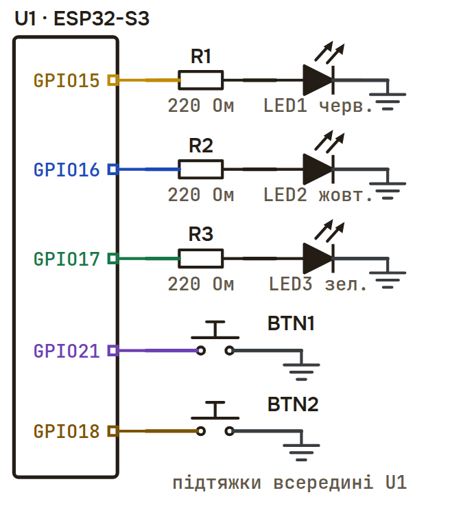
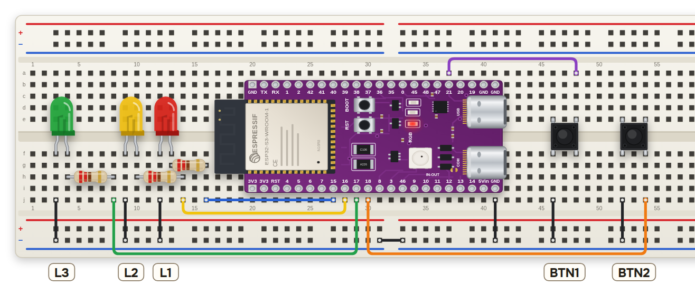

# ESP32-S3: «Мультизадачний пристрій» задачами FreeRTOS — Модуль 6, урок 6.1 (ДЗ)

ДЗ уроку 2.3, але кожна справа — своя задача FreeRTOS (`xTaskCreatePinnedToCore()`), а не шматок суперциклу.
Поведінка та сама, що в [esp32-s3-multitask-device](../esp32-s3-multitask-device/): LED3 перемикається кожні
1000 мс, BTN1 по колу міняє період LED2 1000 → 500 → 200 мс, BTN2 вмикає паузу, і тоді світиться LED1.
Теорія і модель планувальника — на [сторінці уроку 6.1](https://grok-rs.github.io/platformio-projects/lessons/6-1/).

```bash
cd esp32-s3-freertos-device/cpp  && pio run -t upload && pio device monitor          # C, ESP-IDF: src/main.c
cd esp32-s3-freertos-device/rust && source ~/export-esp.sh && cargo run --release    # Rust, ESP-IDF: src/main.rs
```

> **Статус.** Обидві прошивки зібрані (C на ESP-IDF 6.1.0, Rust на esp-idf-hal з ESP-IDF 5.5). C-версія 2026-11-22
> пройшла плату (кнопки на GND): старт без перезавантажень, 20 натискань BTN1 — рівно 20 подій, пауза працює, LED3 на око блимає з кроком 1 с
> ([лог](results/serial-c-20-presses.txt), [ще один](results/serial-c.txt)). Rust-версія того ж дня: 20 швидких
> натискань (≈ 2 за секунду) — рівно 20 подій ([лог](results/serial-rust-20-presses.txt)). На старті Rust ESP-IDF друкує
> `W i2c: This driver is an old driver…`: esp-idf-hal вбудовує старий драйвер I²C, програма його не використовує.
> Часи в логах ставить ПК, а USB плати віддає дані пачками, тож затримок і брязкоту з них не виміряти.

## Схема





Обидві картинки — експорт розділу 08 сторінки уроку (`docs/tools/export.sh`), тож README і сайт показують ту саму
збірку. Те саме текстом:

```
GPIO15 ── 220 Ом ── LED1 червоний ── GND     пауза
GPIO16 ── 220 Ом ── LED2 жовтий ──── GND     період від BTN1
GPIO17 ── 220 Ом ── LED3 зелений ─── GND     завжди 1000 мс
GPIO21 ── BTN1 ── GND                        внутрішня підтяжка: натиснута = 0
GPIO18 ── BTN2 ── GND
```

**Увага:** у суперцикловому `esp32-s3-multitask-device` кнопки під'єднані до **3V3** з pull-down (натиснута = 1).
Тут, як на сторінці уроку 6.1, вони замикають вивід на **GND**. Переставте кнопки на макетці або поміняйте в коді
`== 0` на `== 1` і підтяжку на `pull_down_en`.

| Деталь | Шт. |
|---|---|
| YD-ESP32-S3 (N16R8), кабель USB-C у порт **USB** | 1 |
| LED червоний, жовтий, зелений | по 1 |
| резистор 220 Ом | 3 |
| тактова кнопка | 2 |
| бажано логічний аналізатор: CH1 на GPIO17 (LED3), CH2 на GPIO21 (BTN1) | — |

## Задачі

| Задача | Пріоритет | Ядро | Цикл | Що робить |
|---|---|---|---|---|
| `buttons` | 3 | 1 | `xTaskDelayUntil` 10 мс | опитує обидві кнопки, антибрязкіт 4 опитування (40 мс), пише `speed` і `paused` |
| `led2` | 2 | 1 | `vTaskDelay(SPEEDS[speed])` | перемикає LED2; пауза рахується від кожного перемикання, бо період міняється на ходу |
| `led3` | 2 | 1 | `xTaskDelayUntil` 1000 мс | перемикає LED3 на рівній сітці, без накопичення похибки |
| `heavy` (дослід) | 1, потім 4 | 1 | 80 мс активного очікування, 300 мс сну | закоментована; показує, хто кого витісняє |

`app_main` створює задачі й повертається — задача `main` видаляє себе, а три наші живуть далі. Рядків
«Loops/s» із суперциклової версії тут немає: циклу `loop()` більше немає.

`volatile` для `speed` і `paused` вистачає: однобайтову змінну пише одна задача. Правильніше передавати події чергою,
про це наступні уроки модуля. Стеки (3072 Б з `printf`, 2048 Б у LED-задачах) — оцінка, а не вимір: перевірте
`uxTaskGetStackHighWaterMark()`.

Очікуваний вивід (не запис із плати):

```
Мультизадачний пристрій на FreeRTOS: BTN1 — швидкість LED2, BTN2 — пауза
BTN1 -> LED2 = 500 мс
BTN1 -> LED2 = 200 мс
ПАУЗА вкл
ПАУЗА викл
```

## Перевірка і дослід

| Перевірка | Правильний результат | Плата |
|---|---|---|
| 20 натискань BTN1 | рівно 20 змін періоду LED2; 20 mod 3 = 2, тож останній рядок — 200 мс | C: 20 з 20, натискання кожні 0,8–1,0 с, [лог](results/serial-c-20-presses.txt); Rust: 20 з 20, кожні 0,4–0,6 с, [лог](results/serial-rust-20-presses.txt); обидва закінчили на 200 мс |
| BTN2 | LED1 світиться, LED2 і LED3 завмирають, BTN1 нічого не змінює | C: 3 пари «ПАУЗА вкл / викл», між ними жодного BTN1, [лог](results/serial-c.txt); LED очима не перевірено |
| Період LED3 (аналізатор) | 1000 мс | C: на око ≈ 1 с світить / 1 с ні; аналізатором ще не міряли |

Дослід: розкоментуйте `heavy_task` (у Rust — `spawn(c"heavy", …)`) і поміряйте:

| Варіант | Прогноз | Виміряно | Чому так? |
|---|---|---|---|
| Суперцикл: період LED3, мс | | | |
| Задачі: період LED3, мс | | | |
| Суперцикл + `delayMicroseconds(80000)`: найгірша реакція BTN1, мс | | | |
| Задачі, `heavy` з пріоритетом 1: реакція BTN1, мс | | | |
| Задачі, `heavy` з пріоритетом 4: реакція BTN1, мс | | | |

## C ↔ Rust

| | C (ESP-IDF 6.1) | Rust (esp-idf-hal, ESP-IDF 5.5) |
|---|---|---|
| Задача | `xTaskCreatePinnedToCore(f, "led3", 2048, NULL, 2, NULL, 1)` | `ThreadSpawnConfiguration { priority: 2, pin_to_core: Some(Core1), … }.set()`, потім `thread::spawn` — під капотом та сама задача FreeRTOS |
| Стек | 2048–3072 Б | 4096 Б: `std` і `println!` їдять більше |
| Спільні змінні | `static volatile` | `static AtomicU8` / `AtomicBool`: без `unsafe`, гонку компілятор не пропустить |
| Рівна сітка | `xTaskDelayUntil(&wake, …)` | `wake += period; thread::sleep(…)` |
| Виводи | глобальні номери GPIO, будь-яка задача може писати | кожен `PinDriver` переміщено (`move`) у свою задачу |
| Кінець `main` | `app_main` повертається | `main` спить у циклі |
