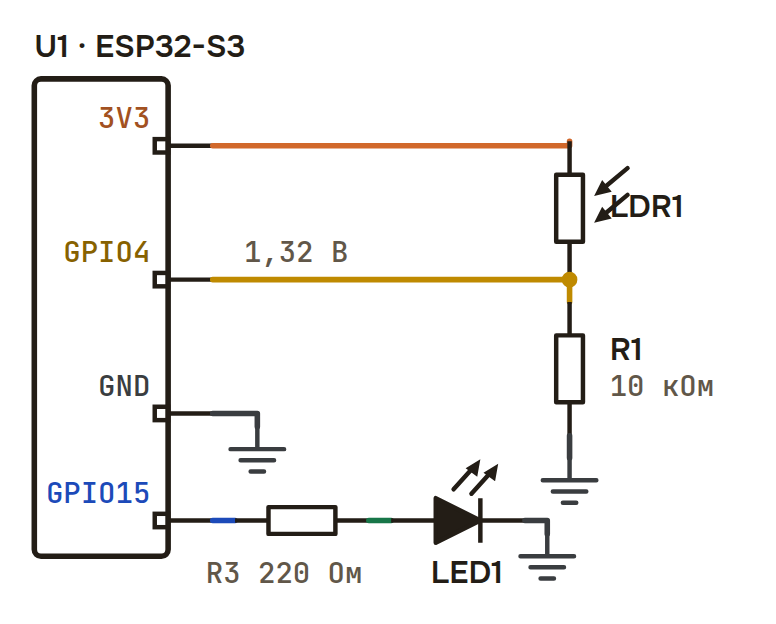
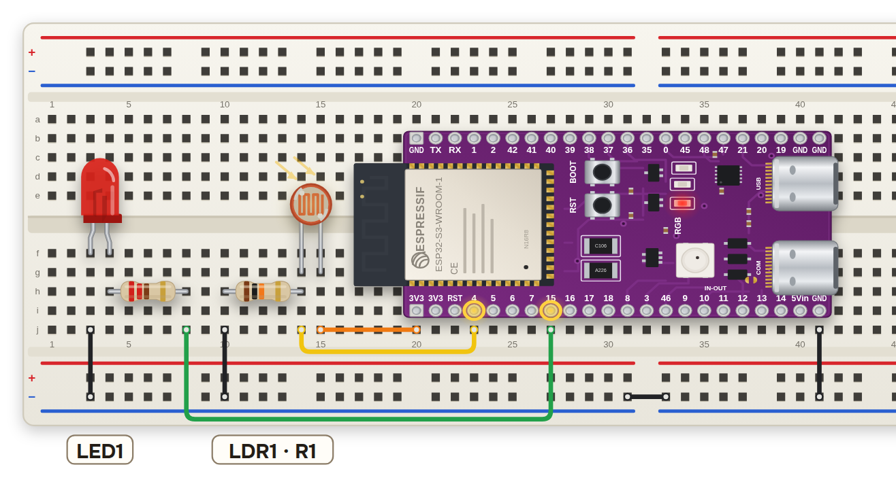

# ESP32-S3: LDR, ковзне середнє і два пороги — Модуль 3, урок 3.1 (ДЗ)

Фоторезистор у подільнику дає напругу на **GPIO4** (ADC1_CH3). Кожні 20 мс програма читає АЦП драйвером ESP-IDF
**oneshot**, згладжує ковзним середнім (SMA) з 16 відліків і порівнює середнє з двома порогами: нижче `DARK` LED на
**GPIO15** вмикається, вище `LIGHT` вимикається, між ними пам'ятає свій стан. Тому LED не мерехтить на межі.
Теорія і віджети — на [сторінці уроку 3.1](https://grok-rs.github.io/platformio-projects/lessons/3-1/).

```bash
cd esp32-s3-ldr-sma/cpp  && pio run -t upload && pio device monitor                # C, ESP-IDF: src/main.c
cd esp32-s3-ldr-sma/rust && source ~/export-esp.sh && cargo run --release          # Rust, ESP-IDF: src/main.rs
```

> **Статус.** Обидві прошивки зібрані (C на ESP-IDF 6.1.0, Rust на esp-idf-hal з ESP-IDF 5.5). Стенд 2026-11-22:
> - C, пороги 1400 / 1700 ([лог](results/serial-c-1400-1700.txt)): кімната — sma 3543…3573 (шум ≈ ±15), долоня — до 1196;
>   10 перемикань (5 ON, 5 OFF) строго по черзі, щоразу ON нижче 1400 і OFF вище 1700, без мерехтіння.
> - C, пороги 1800 / 2600 ([лог](results/serial-c-1800-2600.txt)): звичайна тінь уже вмикає LED; 14 перемикань
>   (7 ON, 7 OFF) строго по черзі, кожне за своїм порогом. Скільки разів накривали, не записали.
> - Rust, пороги 1800 / 2600 ([лог](results/serial-rust.txt)): старт без помилок, кімната — sma 3456…3593;
>   LDR у цьому прогоні не накривали, тож перемикання LED у Rust ще не перевірені.
>
> Рядок у монітор — раз на 320 мс, а пороги перевіряються кожні 20 мс: два перемикання в одному вікні лог не покаже,
> тому рахуйте накривання самі.

## Схема





Обидві картинки — експорт розділу 08 сторінки уроку (`docs/tools/export.sh`), тож README і сайт показують ту саму
збірку. Те саме текстом:

```
3V3 ── LDR ──┬── 10 кОм ── GND
             └── GPIO4 (ADC1_CH3)        більше світла → менший опір LDR → більша напруга
GPIO15 ── 220 Ом ── LED ── GND
```

| Деталь | Шт. |
|---|---|
| YD-ESP32-S3 (N16R8), кабель USB-C у порт **USB** | 1 |
| фоторезистор (GL5528 з уроку 1.6) | 1 |
| резистор 10 кОм, 220 Ом | по 1 |
| LED | 1 |
| макетка, дроти, мультиметр | — |

Верх подільника — лише **3V3**, не 5V. GPIO26–37 не беріть: на N16R8 вони зайняті flash і PSRAM.

## Як це працює

```c
sum = sum - buf[i] + raw;   // найстаріше виходить, нове входить: сума за O(1), без циклу по вікну
buf[i] = raw;
i = (i + 1) % N;
int sma = sum / N;
if (!on && sma < DARK)  { on = true;  gpio_set_level(LED, 1); }   // два різні пороги —
if (on  && sma > LIGHT) { on = false; gpio_set_level(LED, 0); }   // між ними нічого не змінюється
```

- `vTaskDelayUntil()` тримає рівний крок 20 мс, хоч би скільки тривали читання й друк.
- Поки вікно не заповнене (перші 16 відліків, 320 мс), рішень немає: середнє з нулями було б заниженим.
- Рядок у монітор — раз на вікно (коли `i` повертається в 0), щоб монітор не захлинувся.
- `DARK` 1800 і `LIGHT` 2600 підібрано на нашому стенді (кімната ≈ 3560, долоня ≈ 1200; перший прогін був із прикладом
  1400 / 1700 зі сторінки уроку). Свої пороги візьміть з вимірів: `DARK` трохи вище за «сутінки», `LIGHT` —
  посередині між «сутінками» й «кімнатою».

Очікуваний вигляд виводу (числа вигадані, це не запис із плати):

```
ДЗ 3.1: LDR, SMA з 16 відліків, пороги DARK 1800 / LIGHT 2600
raw: 2312  sma: 2298  led: OFF
raw: 1288  sma: 1730  led: OFF
raw: 1102  sma: 1121  led: ON
```

`sma` запізнюється за `raw` і змінюється плавно, а `led` перемикається лише за межами порогів.

## Виміри

| Умова | Прогноз raw | Виміряно sma | Розкид raw (мін…макс за 10 рядків) | LED |
|---|---|---|---|---|
| Долоня щільно | | | | |
| Сутінки (світло вимкнено) | | | | |
| Кімната | | | | |
| Ліхтарик телефона | | | | |

Перевірка: повільно опустіть і підніміть долоню 10 разів — LED має перемкнутися рівно 20 разів, без мерехтіння.

Що якщо… `N 1` і ті самі 10 проведень? Конденсатор 100 нФ від GPIO4 до GND — як зміниться розкид raw?

## C ↔ Rust

| | C (ESP-IDF 6.1) | Rust (esp-idf-hal, ESP-IDF 5.5) |
|---|---|---|
| АЦП | `adc_oneshot_new_unit()`, `adc_oneshot_config_channel()` | `AdcDriver::new(p.adc1)`, `AdcChannelDriver::new(&adc, p.pins.gpio4, …)` |
| Канал | `ADC_CHANNEL_3` вручну: легко сплутати з номером GPIO | бере пін `gpio4`, канал виводить сам; не-АЦП-пін не скомпілюється |
| Читання | `adc_oneshot_read(adc, LDR_CH, &raw)` | `ldr.read_raw()?` |
| Рівний крок | `vTaskDelayUntil(&wake, …)` | `wake += PERIOD; thread::sleep(…)` |
