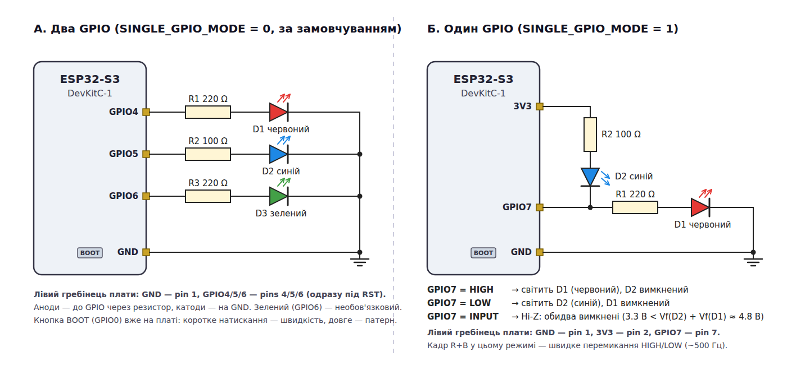
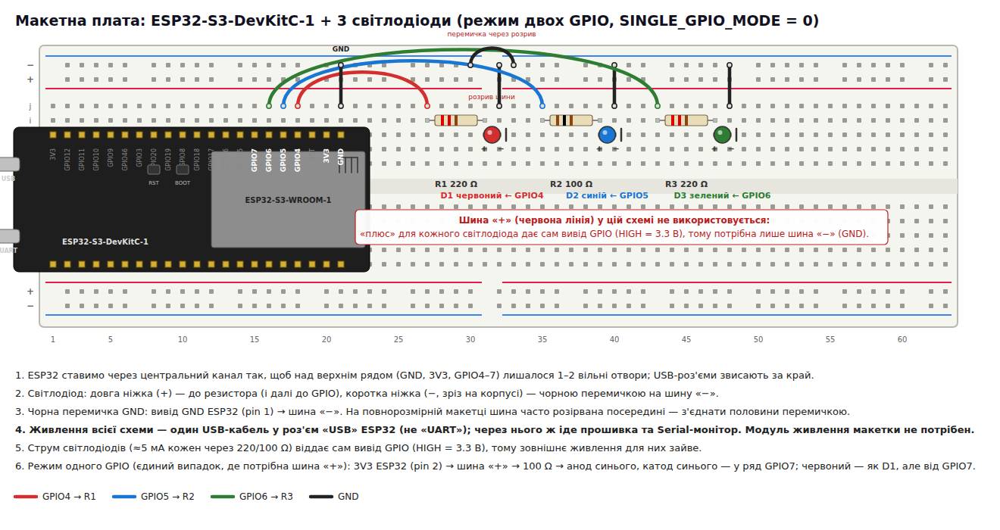
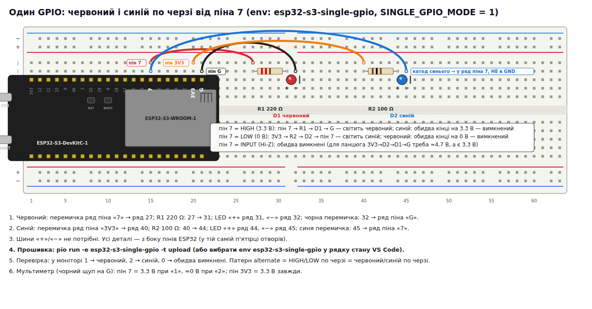

# ESP32-S3: почергове миготіння світлодіодів

Червоний і синій світлодіоди блимають **по черзі**, кожен по 500 мс. Два варіанти:

- **два GPIO** (основне завдання) — червоний на GPIO4, синій на GPIO5;
- **один GPIO** (додаткове) — обидва світлодіоди на GPIO7: `HIGH` → червоний, `LOW` → синій, `INPUT` → обидва згаслі.

```bash
cd esp32-s3-led-blink/cpp && pio run -t upload && pio device monitor                 # C++: src/two_gpio.cpp
cd esp32-s3-led-blink/cpp && pio run -e single-gpio -t upload && pio device monitor  # C++: src/single_gpio.cpp
cd esp32-s3-led-blink/rust && cargo run --release --bin two-gpio                     # Rust: src/bin/two_gpio.rs
cd esp32-s3-led-blink/rust && cargo run --release --bin single-gpio                  # Rust: src/bin/single_gpio.rs
```

## Схема





```
GPIO4 ── 220 Ом ── LED червоний ──┐
GPIO5 ── 100 Ом ── LED синій ─────┤
GND ──────────────────────────────┴── пін G (останній на лівому гребінці, біля USB-C, поруч із 5V)
```

Довга ніжка LED — до резистора, коротка — до GND. Синьому — 100 Ом: у нього пряме падіння ≈3 В, з 220 Ом
він тьмяний. Зелений LED на GPIO6 і кнопка BOOT на малюнках — від старої розширеної версії, прошивка їх
не використовує. Живлення — кабель у роз'єм **USB** (нативний USB ESP32-S3), не **COM**: Serial іде саме туди.
GPIO4…7 безпечні: не strapping (0/3/45/46), не USB (19/20), не флеш/PSRAM (26–37).

### Один GPIO



```
GPIO7 ── 220 Ом ── LED червоний ── GND      світить при HIGH (вивід віддає струм)
3V3   ── 100 Ом ── LED синій ──── GPIO7     світить при LOW  (вивід втягує струм)
```

## Як це працює

Два GPIO — класичний Blink на `delay()`, лише з двома виводами в протифазі:

```cpp
digitalWrite(LED_RED, HIGH); digitalWrite(LED_BLUE, LOW);   // світить червоний
delay(STEP);
digitalWrite(LED_RED, LOW);  digitalWrite(LED_BLUE, HIGH);  // світить синій
delay(STEP);
```

Один GPIO: світлодіоди «дивляться» в різні боки від виводу, тож рівень вибирає, який з них світить.
Третій стан — `pinMode(LED_PIN, INPUT)` (Hi-Z): струм через вивід не тече, а між 3V3 і GND лишаються
два LED послідовно, яким треба ≈1.8 + 3.0 = 4.8 В — більше, ніж 3.3 В, тому обидва гаснуть. Одночасно
обидва світити на одному виводі не можуть (лише швидким чергуванням HIGH/LOW). У Rust той самий трюк —
`Flex`: `set_output_enable(true/false)` замість `pinMode(OUTPUT/INPUT)`.

## Якщо не світиться

1. Мультиметр, чорний щуп на пін **G**: пін `4` = 3.3 В (коли світить червоний), довга ніжка LED ≈ 1.9 В, коротка = 0 В.
   - 3.3 В на довгій ніжці → світлодіод перевернутий;
   - від'ємна напруга → чорний щуп не на GND (найчастіше на сусідньому 5V);
   - 0 В на піні → плата не вставлена в макетку до кінця.
2. Мінімальна схема для перевірки — один LED без шин живлення: [`docs/breadboard_step1.png`](docs/breadboard_step1.png).
