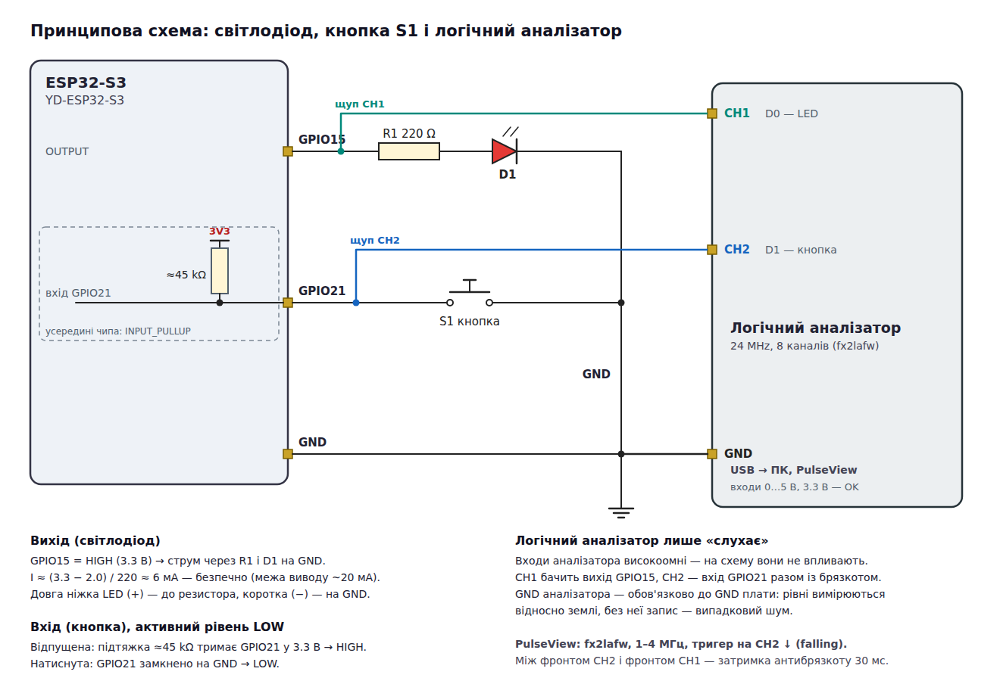
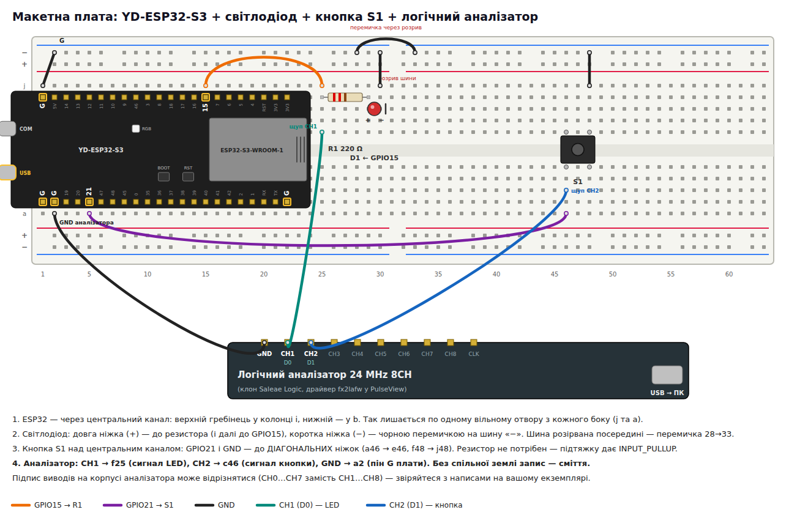

# ESP32-S3: світлодіод і кнопка

Урок у два кроки: один світлодіод (через резистор 220 Ω) і одна кнопка.

Плата — **YD-ESP32-S3** (VCC-GND Studio, клон ESP32-S3-DevKitC-1, N16R8).

| Крок | Середовище / бінарник | Файл (C++ · Rust) | Що робить |
|------|------------|------|-----------|
| 1 | `hold`   | [`cpp/src/hold.cpp`](cpp/src/hold.cpp) · [`rust/src/bin/hold.rs`](rust/src/bin/hold.rs) | LED світить, **поки** кнопку тримають |
| 2 | `toggle` (за замовчуванням) | [`cpp/src/toggle.cpp`](cpp/src/toggle.cpp) · [`rust/src/bin/toggle.rs`](rust/src/bin/toggle.rs) | кожне **натискання** перемикає LED: увімк. ↔ вимк. (з антибрязкотом) |

```bash
cd esp32-s3-led-button/cpp
pio run -e hold -t upload && pio device monitor     # крок 1
pio run -e toggle -t upload && pio device monitor   # крок 2 (або просто pio run -t upload)
```

### Симуляція

| Де | Як |
|----|----|
| VS Code | розширення *Wokwi Simulator*, відкрити теку `cpp/`, `pio run`, далі F1 → *Wokwi: Start Simulator*; клавіша `1` = кнопка |
| CLI / автотест | `wokwi-cli cpp --scenario ../wokwi/scenarios/toggle.yaml --timeout 10000` (токен — у `../.envrc`) |

`cpp/wokwi.toml` вказує на прошивку `toggle`; щоб симулювати крок 1 — `pio run -e hold` і замінити
`toggle` на `hold` у шляхах. `diagram.json` — та сама макетка, що й у
[`esp32-s3-two-buttons`](../esp32-s3-two-buttons/), без другого LED і BOOT.

---

## 1. Компоненти

| Кількість | Компонент                 | Примітка                                                     |
|-----------|---------------------------|--------------------------------------------------------------|
| 1         | YD-ESP32-S3 (N16R8)       | клон ESP32-S3-DevKitC-1                                      |
| 1         | Світлодіод 5 мм           | червоний, жовтий або зелений                                 |
| 1         | Резистор 220 Ω            | смуги: червона-червона-коричнева(-золота)                    |
| 1         | Тактова кнопка 6×6 мм     | 4 ніжки                                                      |
| ~4        | Перемички «тато-тато»     |                                                              |
| 1         | Макетна плата             |                                                              |
| 1         | USB-C кабель              | у роз'єм **USB** (не **COM**) — Serial іде через нативний USB |

## 2. Схема

| Функція     | GPIO | Режим          | Під'єднання                                |
|-------------|------|----------------|--------------------------------------------|
| Світлодіод  | 15   | `OUTPUT`       | GPIO15 → 220 Ω → анод (довга ніжка) → катод → GND |
| Кнопка      | 21   | `INPUT_PULLUP` | GPIO21 → кнопка → GND                       |



Обидва виводи — не strapping (0, 3, 45, 46), не USB (19, 20) і не флеш/PSRAM (26…37).

**Струм світлодіода:** `I = (3.3 В − 2.0 В) / 220 Ω ≈ 6 мА` — яскраво й далеко від межі виводу
(≤ 20 мА). Без резистора струм обмежує лише вивід — LED і GPIO можуть вигоріти.

**Кнопка й підтяжка.** `INPUT_PULLUP` вмикає всередині чипа резистор ~45 кОм до 3.3 В: відпущена
кнопка читається як `HIGH`, натиснута замикає вивід на GND → `LOW`. Тому в коді
`pressed = digitalRead(pin) == LOW`. Без підтяжки відпущений вхід «висить» і читає випадкові значення.

## 3. Монтаж на макетній платі



1. ESP32-S3 через центральний канал: верхній гребінець — у колонку `i`, нижній — у `b`.
2. **GND:** пін `G` біля USB-C → шина «−». Якщо шина розірвана посередині, з'єднати половини перемичкою.
3. **LED:** GPIO15 → ряд 25; резистор 220 Ω — ряди 25…29; довга ніжка LED — ряд 29, коротка — ряд 30; ряд 30 → шина «−».
4. **Кнопка:** над центральним каналом, ніжки в рядах 46 і 48. GPIO21 → `a46`; `j48` → шина «−».
   Беріть **діагональні** ніжки: пари ніжок з'єднані всередині постійно.

5. **Логічний аналізатор:** CH1 → `f25` (сигнал LED), CH2 → `c46` (сигнал кнопки), GND → `a2`
   (пін `G` плати). Спільна земля обов'язкова. У PulseView CH1/CH2 називаються D0/D1.

**Перед увімкненням:** 3V3/5V ніде не з'єднані з GND; довга ніжка LED — з боку резистора.

### Запис у PulseView

1. Аналізатор — у USB комп'ютера; PulseView → драйвер **fx2lafw**, частота **1–4 МГц**, вибірок **≥ 4 M**.
2. Тригер на D1 (кнопка): falling edge. Run → натиснути кнопку.
3. `toggle`: на D1 видно брязкіт при натисканні, а D0 (LED) перемикається через ~30 мс після
   останнього відскоку — це і є затримка антибрязкоту. Виміряйте її курсорами.
4. `hold`: D0 повторює D1 інвертовано, разом із брязкотом — і на світлодіоді його не видно лише тому,
   що він триває мілісекунди.

У Wokwi той самий аналізатор уже стоїть у `diagram.json` (канали `LED`, `BUTTON`); після зупинки
симуляції він зберігає VCD, який відкривається в PulseView.

## 4. Крок 1 — `hold`: стан кнопки → стан LED

```cpp
const bool pressed = digitalRead(kButtonPin) == LOW;
digitalWrite(kLedPin, pressed ? HIGH : LOW);
```

Найпростіший зв'язок «вхід → вихід»: програма просто копіює рівень. У монітор пише лише **зміни**
(`Button pressed -> LED ON`), бо `loop()` виконується тисячі разів на секунду.

## 5. Крок 2 — `toggle`: подія натискання

Тепер важливо не те, *чи* кнопка натиснута, а *момент* натискання — перехід `HIGH → LOW`.
Наївний варіант:

```cpp
if (digitalRead(kButtonPin) == LOW) ledOn = !ledOn;   // ✗
```

перемикає LED на кожному проході `loop()`, поки кнопку тримають, — результат випадковий.
Запам'ятати попередній рівень і реагувати на перехід — уже краще, але не досить:

**Брязкіт контактів.** При замиканні механічні контакти кілька мілісекунд відскакують, і
`digitalRead()` бачить `LOW HIGH LOW HIGH LOW…`. Кожен такий «відскок» став би окремим
натисканням — LED перемикався б 2–5 разів і лишався у випадковому стані.

**Антибрязкіт** у `buttonPressedEvent()`: новий рівень приймається, лише коли він не змінювався
`kDebounceMs` = 30 мс. Будь-який відскок перезапускає відлік. Подія «натиснуто» — це момент, коли
підтверджений рівень стає `LOW`:

```cpp
if (reading != lastReading) {          // рівень змінився — відскок або початок натискання
  lastReading = reading;
  lastChange  = millis();              // почати відлік заново
  return false;
}
if (millis() - lastChange < kDebounceMs || reading == stableLevel) return false;
stableLevel = reading;                 // тримається 30 мс — приймаємо
return stableLevel == LOW;             // true лише на натискання, не на відпускання
```

Без `delay()`: кнопка опитується щомілісекунди, а програма вільна робити щось інше.

## 6. Перевірка роботи

1. `hold`: LED світить, поки тримаєте кнопку; у моніторі `Button pressed` / `Button released`.
2. `toggle`: натиснули й відпустили — LED увімкнувся й лишився; ще раз — вимкнувся.
   У моніторі `Press #1 -> LED ON`, `Press #2 -> LED OFF`… Номер має рости рівно на 1 за натискання.
3. Експеримент: у `toggle.cpp` (або `DEBOUNCE` у `toggle.rs`) поставте `kDebounceMs = 0` і натискайте — номери «стрибають» на 2–3,
   а LED іноді не перемикається. Це і є брязкіт. Його можна побачити й логічним аналізатором
   на GPIO21 (див. [`esp32-s3-button-bounce`](../esp32-s3-button-bounce/)).

## 7. Якщо щось не працює

| Симптом                               | Що перевірити                                                          |
|---------------------------------------|-------------------------------------------------------------------------|
| LED не світить ніколи                 | LED перевернутий (довга ніжка — до резистора); немає GND на шині        |
| LED світить постійно (`hold`)         | кнопка на ніжках, з'єднаних постійно, — взяти діагональні               |
| Кнопка не реагує                      | провід не в ряду GPIO21 (напис `21`, між `47` і `20`)                   |
| LED світить тьмяно                    | синій/білий LED (U ≈ 3 В) з 220 Ω дає лише ~1.4 мА — візьміть червоний  |
| Монітор порожній / порту немає        | кабель у роз'ємі **COM** або кабель лише для заряджання                 |

## 8. Контрольні питання

1. Навіщо резистор послідовно зі світлодіодом? Розрахуйте струм для 220 Ω і 330 Ω.
2. Чому натиснута кнопка читається як `LOW`? Що змінилося б із `INPUT_PULLDOWN`?
3. Чим «кнопка натиснута» відрізняється від «кнопку натиснули»?
4. Що таке брязкіт контактів і чому він заважає кроку 2, але не кроку 1?
5. Чому `millis() - lastChange` залишається коректним після переповнення `millis()`?

## Rust-версія

Той самий урок на Rust — тека [`rust/`](rust/): **esp-hal** (HAL від Espressif) і **Embassy**
(async/await), без Arduino і без ESP-IDF. Вивід у Serial і поведінка — ті самі, тож і автотест Wokwi
той самий. Встановлення тулчейну й загальні правила — у [кореневому README](../README.md#rust).

```bash
source ~/export-esp.sh                       # тулчейн Xtensa від espup, раз на термінал
cd esp32-s3-led-button/rust
cargo run --release --bin hold               # крок 1: зібрати, прошити, відкрити монітор
cargo run --release                          # крок 2 (toggle — бінарник за замовчуванням)
cargo +stable host-test -p led-button        # тести антибрязкоту на ПК, без плати
```

Wokwi: `cargo build --release`, далі в теці `rust/` F1 → *Wokwi: Start Simulator*, або з теки проєкту
`wokwi-cli rust --scenario ../wokwi/scenarios/toggle.yaml --timeout 10000`.

| | C++ (Arduino) | Rust (esp-hal + Embassy) |
|---|---|---|
| Два кроки | два середовища `hold` / `toggle`, `build_src_filter` | два бінарники `src/bin/hold.rs` / `toggle.rs` |
| Виводи | `pinMode(15, OUTPUT)`, номер — просто число | `Output::new(peripherals.GPIO15, …)`: пін переміщується в драйвер, вдруге його не взяти |
| `pressed ? HIGH : LOW` | тернарний оператор | `led.set_level(pressed.into())` — `Level: From<bool>` |
| Антибрязкіт | глобальні `stableLevel`, `lastReading`, `lastChange` + функція | структура `Debouncer` у `src/lib.rs`, тести на ПК |
| Час | `millis()` (`uint32_t`, переповнення через 49 діб) | `Instant` / `Duration` (64 біти, одиниці в типі) |
| Пауза 1 мс | `delay(1)` блокує ядро | `Ticker` / `Timer::after_millis(1).await` — ядро вільне |

## Структура

```
cpp/
  platformio.ini      плата YD-ESP32-S3 N16R8; середовища hold і toggle
  src/hold.cpp        крок 1: LED = стан кнопки
  src/toggle.cpp      крок 2: натискання перемикає LED, антибрязкіт 30 мс
  wokwi.toml          прошивка toggle з .pio/build для Wokwi (diagram.json — посилання на ../diagram.json)
rust/
  Cargo.toml          пакет led-button у робочому просторі Cargo (корінь репозиторію)
  src/lib.rs          Debouncer — антибрязкіт без заліза, з тестами
  src/bin/hold.rs     крок 1
  src/bin/toggle.rs   крок 2
  wokwi.toml          прошивка toggle з ../../target для Wokwi
diagram.json          схема Wokwi (макетка), спільна для обох версій
wokwi/scenarios/      автотест wokwi-cli (той самий для C++ і Rust)
docs/
  schematic.png/svg   принципова схема з логічним аналізатором
  breadboard.png/svg  розкладка на макетній платі з аналізатором
  tools/              генератори діаграм (python3 + headless Chrome): tools/render.sh
```
