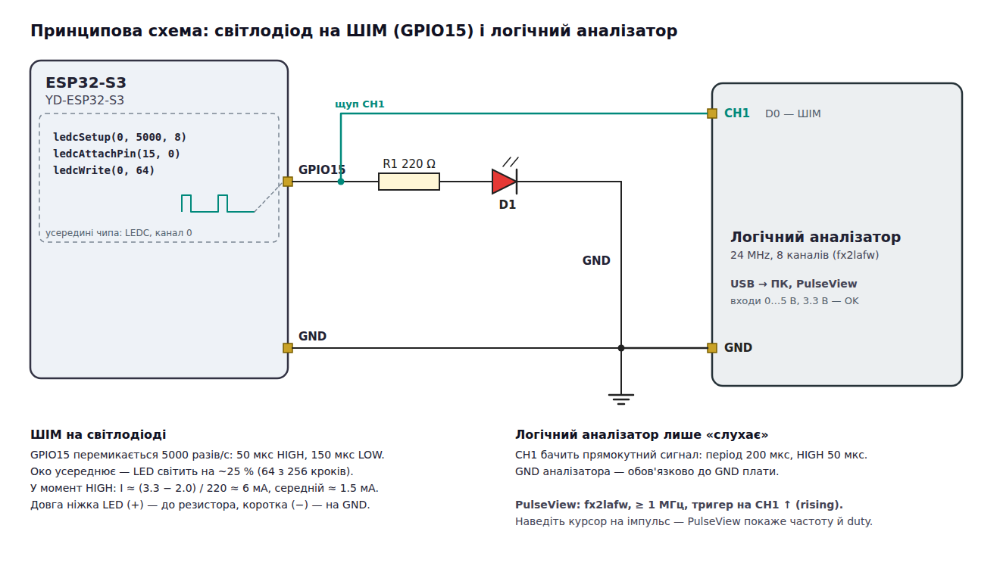
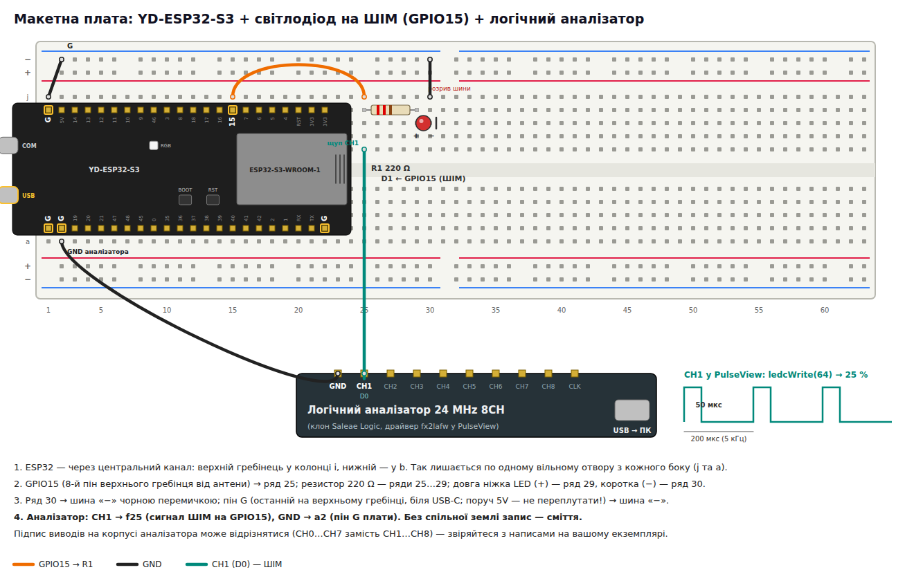

# ESP32-S3: яскравість світлодіода через ШІМ (PWM)

Урок за викладачем (проєкт `Blink_Correct`): світлодіод на GPIO15 світить не на повну, а на ~25 %
яскравості. Код у [`cpp/src/main.cpp`](cpp/src/main.cpp) повторює код з уроку рядок у рядок — щоб можна було
набирати разом із викладачем.

Плата — **YD-ESP32-S3** (VCC-GND Studio, клон ESP32-S3-DevKitC-1, N16R8).

```bash
cd esp32-s3-led-pwm/cpp
pio run -t upload
```

## 1. Схема



### Монтаж на макетній платі



1. ESP32-S3 через центральний канал: верхній гребінець — у колонку `i`, нижній — у `b`.
2. GPIO15 → ряд 25; резистор 220 Ω — ряди 25…29; довга ніжка LED (+) — ряд 29, коротка (−) — ряд 30.
3. Ряд 30 → шина «−»; пін `G` біля USB-C → шина «−» (поруч `5V` — не переплутати).
4. Логічний аналізатор: **CH1 → `f25`** (сигнал ШІМ), **GND → `a2`** (пін `G` плати).

## 2. Що таке ШІМ

Цифровий вивід уміє лише 0 В або 3.3 В — «напівнапруги» він не видає. ШІМ (широтно-імпульсна модуляція,
PWM) дуже швидко вмикає й вимикає вивід. Око не встигає за 5000 миганнями на секунду й бачить
**середню** яскравість, яка залежить від того, яку частку періоду вивід у HIGH — **коефіцієнт заповнення**
(duty cycle).

```
duty 25 %  (ledcWrite 64)    ▔|____|▔|____|▔|____     світить слабко
duty 50 %  (ledcWrite 128)   ▔▔|__|▔▔|__|▔▔|__
duty 100 % (ledcWrite 255)   ▔▔▔▔▔▔▔▔▔▔▔▔▔▔▔▔▔▔     майже як digitalWrite(HIGH)
           |<-- 200 мкс -->|  період = 1 / 5000 Гц
```

## 3. Код — три кроки LEDC

На ESP32 ШІМ робить апаратний блок **LEDC** (LED Control). У нього є канали (на ESP32-S3 — 8, номери 0…7);
канал генерує сигнал, а пін лише «підключається» до каналу.

| Рядок | Що робить |
|-------|-----------|
| `ledcSetup(ledChannel, 5000, 8);` | канал 0: частота **5000 Гц**, розрядність **8 біт** |
| `ledcAttachPin(LED_OUT, ledChannel);` | вивести сигнал каналу 0 на GPIO15 |
| `ledcWrite(ledChannel, 64);` | заповнення: 64 з 256 кроків = **25 %** |

**Розрядність** задає, на скільки кроків ділиться період: 8 біт → 2⁸ = **256** рівнів, значення
`ledcWrite` — **0…255** (саме це викладач записав як `0-255 256`). 10 біт дали б 0…1023 — плавніше,
але максимальна частота менша: `частота × 2^біт ≤ 80 МГц`.

`loop()` порожній: після `ledcWrite` сигнал генерує апаратний блок сам, процесор більше нічого не робить.

> **Версія ядра.** `ledcSetup()` і `ledcAttachPin()` — API Arduino-ESP32 **2.x**, який стоїть у цьому
> репозиторії (`espressif32@^7.1.0` → core 2.0.17). У core 3.x їх прибрали; там те саме пишеться як
> `ledcAttach(LED_OUT, 5000, 8); ledcWrite(LED_OUT, 64);` — канал вибирається автоматично, а
> `ledcWrite` приймає номер піна.

## 4. Перевірка

1. Після прошивки LED світить помітно слабше, ніж у проєкті з `digitalWrite(HIGH)`.
2. Замініть `64` на `0`, `16`, `128`, `255` — яскравість змінюється. Зверніть увагу: між 128 і 255 різниця
   на око менша, ніж між 16 і 64 — око сприймає яскравість нелінійно.
3. **Логічний аналізатор** (PulseView, fx2lafw, частота ≥ 1 МГц): на CH1 — прямокутний сигнал з періодом
   200 мкс і HIGH 50 мкс. PulseView сам покаже частоту й duty, якщо навести курсор на імпульс.
   У Wokwi той самий аналізатор уже стоїть у `diagram.json` (канал `LED`).

## 5. Завдання для самоперевірки

1. Яке значення `ledcWrite` дасть 50 % і 75 % при 8 бітах? А при 10 бітах?
2. Що зміниться, якщо поставити частоту 5 Гц? Чому LED почне мигати?
3. Напишіть `loop()`, що плавно збільшує яскравість від 0 до 255 і назад (крок 1, `delay(5)`).

## Rust-версія

Тека [`rust/`](rust/) — те саме на **esp-hal** + **Embassy**. Встановлення тулчейну — у
[кореневому README](../README.md#rust).

```bash
source ~/export-esp.sh                 # тулчейн Xtensa від espup, раз на термінал
cd esp32-s3-led-pwm/rust
cargo run --release                    # зібрати, прошити, відкрити монітор
```

Wokwi: `cargo build --release`, далі в теці `rust/` F1 → *Wokwi: Start Simulator*. Логіки без заліза
тут немає, тож і `src/lib.rs` з тестами теж.

| Arduino (core 2.x) | esp-hal | Що робить |
|---|---|---|
| `ledcSetup(0, 5000, 8)` | `ledc.timer::<LowSpeed>(Timer0).configure(Config { duty: Duty8Bit, frequency: Rate::from_khz(5), … })` | таймер: частота й розрядність; помилка — `Result`, а не мовчазний 0 |
| `ledcAttachPin(15, 0)` | `ledc.channel(Channel0, peripherals.GPIO15).configure(…)` | канал на пін; пін переміщується в канал |
| `ledcWrite(0, 128)` | `channel0.set_duty_cycle(128)` | трейт `SetDutyCycle` з **embedded-hal** — однаковий для будь-якого мікроконтролера |
| порожній `loop()` | `loop { Timer::after_secs(1).await }` | процесор спить, сигнал генерує LEDC |

> **Увага:** у `cpp/src/main.cpp` зараз `ledcWrite(ledChannel, 128)` — це **50 %**, хоча коментар у
> тому рядку й таблиці вище говорять про 64 / 25 %. Rust-версія повторює код (`DUTY = 128`).

## Структура

```
cpp/
  platformio.ini   плата YD-ESP32-S3 N16R8, Arduino core 2.0.x
  src/main.cpp     код з уроку: ledcSetup → ledcAttachPin → ledcWrite
  wokwi.toml       прошивка з .pio/build для Wokwi (diagram.json — посилання на ../diagram.json)
rust/
  Cargo.toml       пакет led-pwm у робочому просторі Cargo (корінь репозиторію)
  src/main.rs      LEDC: таймер → канал → set_duty_cycle
  wokwi.toml       прошивка з ../../target для Wokwi
diagram.json     схема Wokwi (LED + логічний аналізатор), спільна для обох версій
docs/
  schematic.png/svg   принципова схема з LEDC і логічним аналізатором
  breadboard.png/svg  розкладка на макетній платі з аналізатором
  tools/              генератори діаграм (python3 + headless Chrome): tools/render.sh
```
