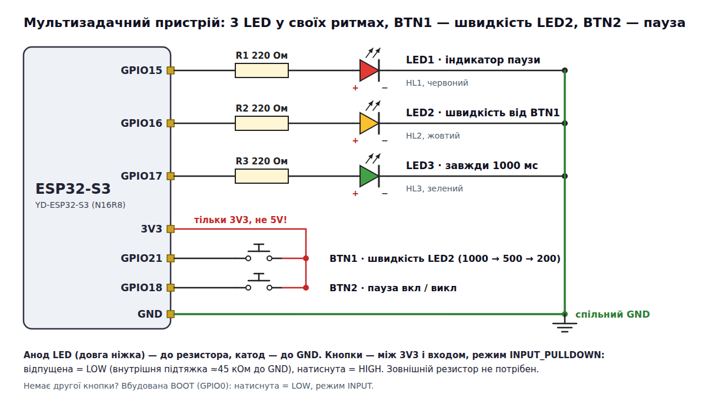

# ESP32-S3: «Мультизадачний пристрій» — фінальний проєкт

Світлодіоди живуть у своїх ритмах, а кнопки керують ними **миттєво** — у жодному місці програма не
стоїть і не чекає. Лише `millis()` у формі `now - last >= INTERVAL`, без `delay()` і `while()` у `loop()`.

* LED3 (зелений) — завжди кожні 1000 мс.
* LED2 (жовтий) — період задає BTN1: 1000 → 500 → 200 → знову 1000 мс.
* BTN2 — пауза: LED2 і LED3 завмирають, LED1 (червоний) світиться. Повторне натискання знімає паузу.
  У паузі BTN1 нічого не змінює.
* Serial: рядок на кожну подію і раз на секунду — кількість проходів `loop()`.

```bash
cd esp32-s3-multitask-device/cpp && pio run -t upload && pio device monitor   # C++: src/main.cpp
cd esp32-s3-multitask-device/rust && cargo run --release                      # Rust: src/main.rs
```

## Схема



```
GPIO15 ── 220 Ом ── LED1 червоний (пауза) ──┐
GPIO16 ── 220 Ом ── LED2 жовтий (BTN1)  ────┤
GPIO17 ── 220 Ом ── LED3 зелений (1000) ────┤
GND ────────────────────────────────────────┴── спільний GND

3V3 ──┬── BTN1 ── GPIO21      INPUT_PULLDOWN: відпущена = LOW, натиснута = HIGH
      └── BTN2 ── GPIO18      (тільки 3V3, не 5 V!)
```

Піни — як у завданні: LED на GPIO15/16/17, BTN1 — GPIO21, BTN2 — GPIO18. Кнопки — між 3V3 і
входом; внутрішня підтяжка до GND робить зовнішній резистор зайвим. Немає другої кнопки — BOOT (GPIO0):
натиснута = LOW, режим `INPUT`, тоді в `pressed()` фронт натискання — це `LOW`.

## Як це працює

Кожен прохід `loop()`: опитати обидві кнопки → обробити події → перевірити таймери LED → звіт.
Нічого не чекає, тому кнопка спрацьовує за ~40 мс навіть тоді, коли LED2 блимає раз на секунду.

**Неблокуючий дебаунс по фронту.** Рівень приймаємо, коли він протримався 40 мс; подія — лише перехід
LOW → HIGH. Брязкіт перезапускає відлік, утримання й відпускання подій не дають — тож 20 швидких
натискань = рівно 20 перемикань, а довге утримання — одне:

```cpp
bool pressed(Button& b, uint32_t now) {
  bool level = digitalRead(b.pin);
  if (level != b.raw) { b.raw = level; b.changedAt = now; }  // брязкіт — відлік заново
  if (now - b.changedAt >= DEBOUNCE && b.raw != b.stable) {
    b.stable = b.raw;
    return b.stable == HIGH;  // фронт натискання
  }
  return false;
}
```

**Швидкість і пауза — змінні стану**, а не затримки: `speed` (індекс у `SPEEDS[] = {1000, 500, 200}`) і
`paused`. Пауза просто не пускає до таймерів LED2/LED3; після паузи `last2 = last3 = now`, щоб LED не
перемкнулися миттєво. Кнопки опитуються й у паузі — інакше дебаунс загубив би фронт.

Serial:

```
Мультизадачний пристрій: BTN1 — швидкість LED2, BTN2 — пауза
BTN1 -> LED2 = 500 мс
BTN1 -> LED2 = 200 мс
ПАУЗА вкл
ПАУЗА викл
Loops/s: …          (кількість проходів loop() за секунду)
```

«Період» тут — інтервал між перемиканнями LED (як `now - last >= INTERVAL` у завданні): LED3
перемикається раз на 1000 мс.

## Критерії прийнятності

| Критерій | Як перевірити |
|---|---|
| LED3 рівно 1000 мс; LED2 міняє період по колу за BTN1 | Serial `BTN1 -> LED2 = …` і секундомір / логічний аналізатор |
| BTN2 ставить на паузу й знімає; LED1 показує паузу | `ПАУЗА вкл` / `ПАУЗА викл`, червоний LED |
| 20 швидких натискань BTN1 — рівно 20 перемикань, утримання — одне | порахувати рядки `BTN1 -> …` у Serial |
| Немає `delay()` і `while()` | `grep -n "delay\|while" cpp/src/main.cpp` — нічого |
| У Serial — кожна подія і `Loops/s` | див. вище |

**Межа polling.** Подія коротша за прохід циклу (мікросекунди) або за 40 мс дебаунсу проґавиться —
для кнопки це не страшно, а для коротких імпульсів (лічильник, енкодер) потрібні переривання.
