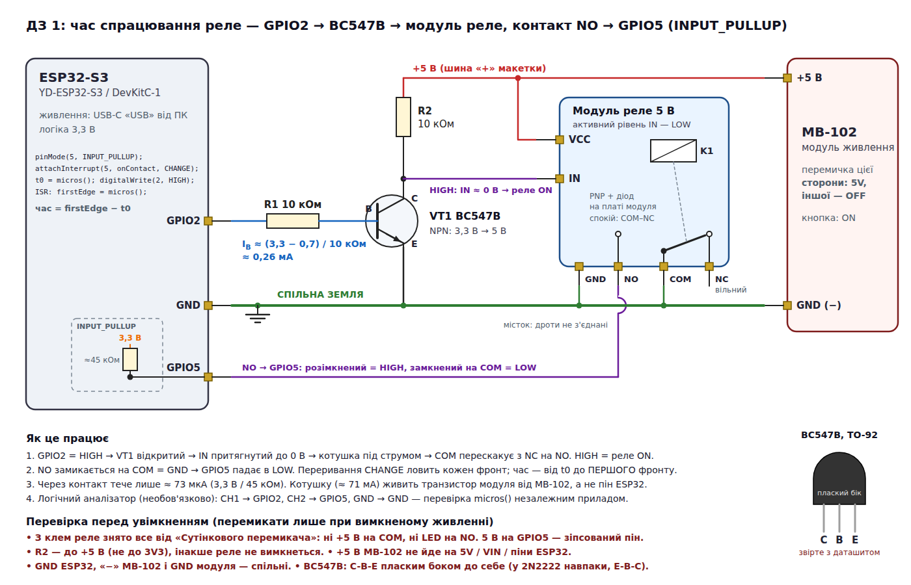
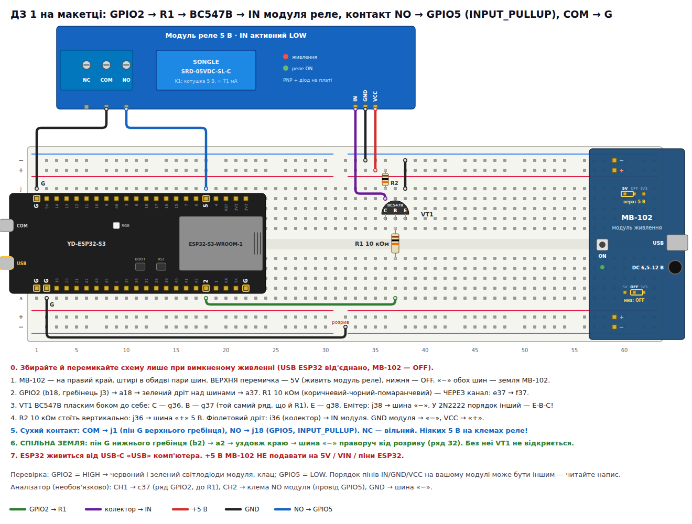
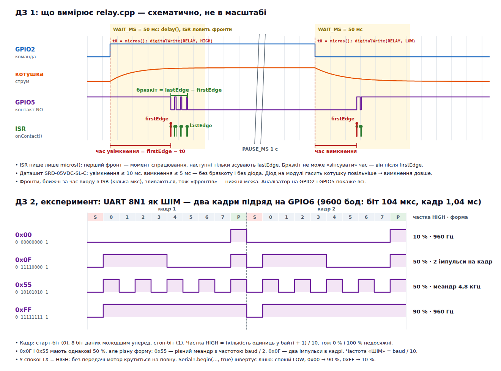
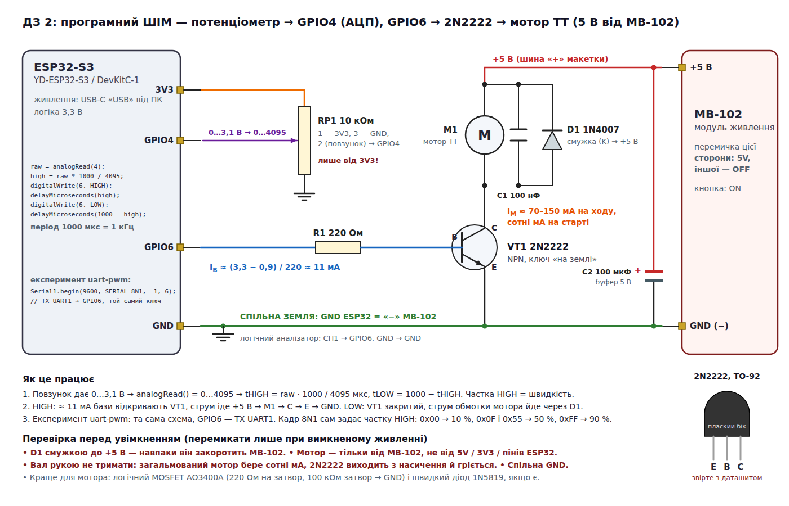
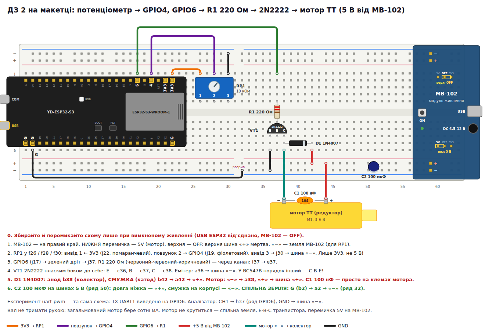

# ESP32-S3: реле, час, переривання та ШІМ — ДЗ модуля 2.2

* **Завдання 1** — виміряти механічну затримку реле: ESP32 вмикає й вимикає котушку, а переривання
  на «сухому» контакті ловить момент, коли контакт справді перемкнувся. 10 циклів, середнє/мін/макс.
* **Завдання 2 (опційне)** — програмний ШІМ для мотора: потенціометр → АЦП → тривалість HIGH і LOW →
  `delayMicroseconds()`. Експеримент: UART як джерело ШІМ.

Теорія, розрахунки й візуалізатори — на сторінці
[«Потужне навантаження»](https://grok-rs.github.io/platformio-projects/power-loads/) (розділи ДЗ 1 і ДЗ 2).
Керування реле — те саме, що в [«Сутінковому перемикачі»](../esp32-s3-twilight-relay/).

```bash
cd esp32-s3-relay-pwm/cpp
pio run -e relay    -t upload && pio device monitor   # ДЗ 1 (за замовчуванням)
pio run -e motor    -t upload && pio device monitor   # ДЗ 2: мотор + потенціометр
pio run -e uart-pwm -t upload && pio device monitor   # ДЗ 2, експеримент: UART як ШІМ

cd esp32-s3-relay-pwm/rust
cargo run --release                                   # relay; --bin motor / uart-pwm
```

Один файл на завдання: `cpp/src/{relay,motor,uart_pwm}.cpp` і `rust/src/bin/*.rs` рядок у рядок.
Щоб зберегти вивід у файл для звіту: `pio device monitor -f log2file`.

## Завдання 1: час спрацювання реле





```
GPIO2 ── R1 10 кОм ── база VT1 (BC547B)          HIGH на GPIO2 = реле ON (подвійна інверсія)
+5 В ─── R2 10 кОм ──┬── колектор VT1
                     └── IN модуля реле
емітер VT1 ── GND

+5 В ── VCC модуля      GND ── GND модуля
COM ── GND ESP32        NO ── GPIO5 (INPUT_PULLUP)      NC — вільний
```

Деталі: модуль реле 5 В (SRD-05VDC-SL-C, active LOW), BC547B, 2 × 10 кОм, MB-102, дроти. Усі GND — спільні.
**З клем реле зніміть усе, що було в «Сутінковому перемикачі»** (+5 В на COM, LED на NO): контакт тепер
комутує лише сигнал ESP32 — 3,3 В через внутрішню підтяжку ≈ 45 кОм, ≈ 73 мкА.

### Як це працює

`micros()` у момент команди → `digitalWrite()` → чекаємо 50 мс → обробник переривання за цей час
записав, коли контакт перемкнувся. Час = перший фронт − команда.



**Брязкіт.** Контакт після замикання ще кілька разів відскакує — переривання `CHANGE` бачить пачку
фронтів. Тому обробник бере час лише з **першого** фронту (це і є момент спрацювання), а наступні тільки
зсувають `lastEdge` і рахуються в `edges`:

```cpp
void IRAM_ATTR onContact() {
  unsigned long t = micros();
  if (edges == 0) firstEdge = t;  // перший фронт — момент спрацювання
  lastEdge = t;                   // останній — кінець брязкоту
  edges++;
}
```

Наступна команда йде лише через 1 с, коли контакт давно заспокоївся, — брязкіт однієї вимірки не
потрапить у наступну. Якби брати **останній** фронт, час вийшов би більшим на тривалість брязкоту.

Serial зі стенда (повний запис — [`docs/bench-relay.serial.txt`](docs/bench-relay.serial.txt)):

```
Реле: час від команди (GPIO2) до першого фронту контакту NO (GPIO5), 10 циклів
#1  увімк  3892 мкс  брязкіт  547 мкс  фронтів 28
#1  вимк   3580 мкс  брязкіт   56 мкс  фронтів 4
…
#10 вимк   3554 мкс  брязкіт   57 мкс  фронтів 6
Увімкнення: середнє 3851 мкс, мін 3830, макс 3892 (10 з 10)
Вимкнення: середнє 3568 мкс, мін 3554, макс 3580 (10 з 10)
```

Серія з 10 циклів іде одна, через 2 с після старту; нова серія — кнопка **RST**.
Якщо фронту немає: `фронту немає: COM → GND? NO → GPIO5? реле клацає?`, а в середнє цей замір не йде.

### Результати

Стенд 30.10.2026: YD-ESP32-S3, модуль реле SRD-05VDC-SL-C, котушка від MB-102 (5 В), прошивка `relay` (C++).

| # | увімкнення, мкс | брязкіт, мкс | вимкнення, мкс | брязкіт, мкс |
|---|---|---|---|---|
| 1 | 3 892 | 547 | 3 580 | 56 |
| 2 | 3 830 | 551 | 3 575 | 67 |
| 3 | 3 852 | 547 | 3 572 | 58 |
| 4 | 3 838 | 551 | 3 572 | 57 |
| 5 | 3 851 | 551 | 3 569 | 64 |
| 6 | 3 832 | 770 | 3 571 | 55 |
| 7 | 3 881 | 551 | 3 566 | 55 |
| 8 | 3 845 | 546 | 3 564 | 53 |
| 9 | 3 846 | 548 | 3 557 | 87 |
| 10 | 3 849 | 519 | 3 554 | 57 |
| **середнє** | **3 851** | **568** | **3 568** | **61** |
| мін … макс | 3 830 … 3 892 | 519 … 770 | 3 554 … 3 580 | 53 … 87 |

**Висновки.**

1. Увімкнення **3,85 мс**, вимкнення **3,57 мс** — обидва в межах даташита (≤ 10 мс і ≤ 5 мс).
2. Розкид між циклами — лише ±30 мкс (увімкнення) і ±13 мкс (вимкнення): механіка реле дуже повторювана.
3. Замикання NO брязкотить ≈ **0,55 мс** (14–28 фронтів), розмикання — ≈ **0,06 мс** (4–14 фронтів):
   при замиканні якір б'ється об нерухомий контакт і відскакує, при розмиканні — просто відходить.
4. Брязкіт не псує вимір: час рахується до **першого** фронту, а всі наступні лише зсувають `lastEdge`.
   Якби брали останній фронт, увімкнення «виросло» б на ≈ 0,55 мс (≈ 14 %).

Орієнтир з даташита SRD-05VDC-SL-C: увімкнення **≤ 10 мс**, вимкнення **≤ 5 мс** — це межі без брязкоту
і **без діода** на котушці. На модулі діод є, він гасить струм котушки повільніше, тому вимкнення
може вийти довшим за 5 мс. На увімкнення діод не впливає.

**Похибка.** Крок `micros()` — 1 мкс; вхід у переривання — кілька мкс (з Wi-Fi — до десятків);
транзистори VT1 і модуля — мікросекунди. Набагато більше важать напруга котушки (5 В від MB-102 чи від
USB?) і розкид між циклами. Фронти, ближчі за час входу в ISR, зливаються, тож `фронтів` — нижня межа.
Незалежна перевірка — логічний аналізатор: CH1 → GPIO2, CH2 → GPIO5; відстань між фронтами CH1 і CH2
має збігтися з числом у Serial.

| Симптом | Ймовірна причина |
|---|---|
| Реле не клацає | немає +5 В на VCC модуля; немає спільної GND; VT1 повернутий (BC547B: C-B-E) |
| Реле не вимикається | R2 до 3V3 замість +5 В, або GPIO2 напряму в IN |
| Клацає, але «фронту немає» | COM не на GND; провід на NC замість NO |
| Час підозріло малий (< 1 мс) | завада від котушки на довгому дроті GPIO5 — коротший дріт, зовнішня підтяжка 4,7–10 кОм до 3V3 |

## Завдання 2 (опційне): програмний ШІМ для мотора





```
3V3 ── RP1 10 кОм ── GND,  повзунок → GPIO4 (ADC1)

GPIO6 ── R1 220 Ом ── база VT1 (2N2222, E-B-C)
+5 В (MB-102) ──┬── мотор M1 ──┬── колектор VT1        емітер VT1 ── GND
                ├── C1 100 нФ ─┤                       C2 100 мкФ між +5 В і GND
                └── D1 1N4007 ─┘  смужкою (K) до +5 В
```

**Розрахунок.** I<sub>Б</sub> ≈ (3,3 − 0,9) / 220 ≈ **11 мА** — пін це дає (до ≈ 20 мА). Мотор TT на ходу бере
≈ 70–150 мА: I<sub>К</sub> / I<sub>Б</sub> ≈ 10–14 — ключ упевнено в насиченні, U<sub>КЕ</sub> — десяті вольта (виміряйте). На старті й
на загальмованому валу — сотні мА, і 11 мА бази вже не вистачає: вал рукою не тримайте. Для мотора краще
логічний MOSFET (AO3400A) і швидкий діод (1N5819) — якщо вони є; з набору підходять 2N2222 і 1N4007.
**D1 обов'язковий**: щоразу, як ключ закривається (1000 разів на секунду), струм обмотки мотора йде через нього.

### Як це працює

```cpp
int raw = analogRead(POT);                         // 0…4095
unsigned long highUs = raw * PERIOD_US / 4095;     // PERIOD_US = 1000 → 1 кГц
unsigned long lowUs = PERIOD_US - highUs;
if (highUs > 0) { digitalWrite(MOTOR, HIGH); delayMicroseconds(highUs); }
if (lowUs > 0)  { digitalWrite(MOTOR, LOW);  delayMicroseconds(lowUs); }
```

Один прохід `loop()` = один період ШІМ. Крайні положення (0 і 4095) тримають пін постійно LOW або HIGH.
Двічі на секунду в Serial — що бачить програма:

```
Мотор: програмний ШІМ 1 кГц на GPIO6, потенціометр на GPIO4
ADC 2048  HIGH  500 мкс  LOW  500 мкс  duty  50 %
```

**Частота 1 кГц** — компроміс: 100 Гц мотор гуде й смикається, 20 кГц тихо, але програмно рівно не вийде
(період лише 50 мкс, а кожен `analogRead()` теж забирає мікросекунди). Мотор на 1 кГц пищить — це нормально.

**Чому програмний ШІМ «тремтить».** `delayMicroseconds()` — активне очікування: процесор нічого іншого не
робить. До періоду додаються `analogRead()`, `Serial.printf()` раз на 500 мс і переривання (USB, тік
FreeRTOS) — на аналізаторі період трохи довший за 1000 мкс і «гуляє». Апаратний LEDC
(`ledcSetup(0, 20000, 10)` + `ledcWrite`) формує ШІМ без процесора — рівно і на 20 кГц.

Аналізатор: CH1 → GPIO6. Заповніть для кількох положень потенціометра:

| ADC (Serial) | HIGH у Serial, мкс | HIGH на аналізаторі, мкс | період на аналізаторі, мкс | мотор |
|---|---|---|---|---|
| | | | | стоїть / гуде / крутиться |

Мотор рушає не з нуля: при малій частці HIGH він лише гуде (тертя спокою) — знайдіть і запишіть поріг.

### Експеримент: UART як джерело ШІМ

`uart-pwm` — та сама схема, але GPIO6 тепер **TX UART1** (`Serial1.begin(9600, SERIAL_8N1, -1, 6)`), який
безперервно шле один байт; кожні 3 с — наступний: 0x00 → 0x0F → 0x55 → 0xFF. `Serial` на нашій платі — це
USB, тому сигнал на пін виводимо через `Serial1`.

Кадр 8N1 — 10 біт: старт (0), 8 біт даних **молодшим уперед**, стоп (1). Частка HIGH =
(одиниці + 1) / 10, частота кадрів = 9600 / 10 = **960 Гц**:

| Байт | На лінії (старт…стоп) | HIGH | Форма | Аналізатор |
|---|---|---|---|---|
| 0x00 | `0 00000000 1` | 10 % | один імпульс на кадр, 960 Гц | |
| 0x0F | `0 11110000 1` | 50 % | два імпульси на кадр (4 біти і 1 біт) | |
| 0x55 | `0 10101010 1` | 50 % | рівний меандр 4,8 кГц (baud / 2) | |
| 0xFF | `0 11111111 1` | 90 % | один провал на кадр, 960 Гц | |

Serial друкує те саме: `0x0F  кадр: 0 11110000 1  HIGH 50 %`.

* 0x0F і 0x55 дають однакові 50 %, але різну форму — мотор крутиться однаково, а звук різний.
* 0 % і 100 % недосяжні: старт-біт завжди 0, стоп-біт завжди 1. Рівний ШІМ кроком 10 % дають
  0x00, 0x80, 0xC0, 0xE0, 0xF0, 0xF8, 0xFC, 0xFE, 0xFF.
* **У спокої TX = HIGH** — поки нічого не передається, мотор крутиться на повну.
  `Serial1.begin(9600, SERIAL_8N1, -1, 6, true)` інвертує лінію: спокій LOW, 0x00 → 90 %, 0xFF → 10 %.
* Нові байти стають у чергу за ≈ 128 байтами FIFO, тому зміна на лінії запізнюється на ≈ 0,13 с.
* У PulseView / Logic 2 додайте декодер **UART (Async Serial)**: 9600, 8N1, канал GPIO6 — він підпише
  кожен кадр; 0x55 — це символ `U`.

## C++ і Rust

| | C++ (Arduino) | Rust (esp-hal) |
|---|---|---|
| Спільні з ISR дані | `volatile unsigned long` | `AtomicU32`; пін у `critical_section::Mutex`, щоб обробник скинув переривання |
| Час | `micros()` | `Instant::now()` → мкс як `u32` (`AtomicU64` на Xtensa немає) |
| «Фронту не було» | `0` | `Option<u32>`: `None` — компілятор не дасть забути перевірку |
| Програмний ШІМ | `delayMicroseconds()` | `Delay::delay_micros()` |
| UART на пін | `Serial1.begin(9600, SERIAL_8N1, -1, 6)` | `UartTx::new(UART1, Config::default().with_baudrate(9600))?.with_tx(GPIO6)` |

## Примітки

1. Піни: GPIO2 і GPIO5 — як у каркасі ДЗ 1 на сайті; GPIO4 (ADC1) і GPIO6 — для ДЗ 2, тож вони не перетинаються.
2. Схеми, розкладки на макетці й часові діаграми згенеровано скриптами з [`docs/tools/`](docs/tools/) (`render.sh`).
