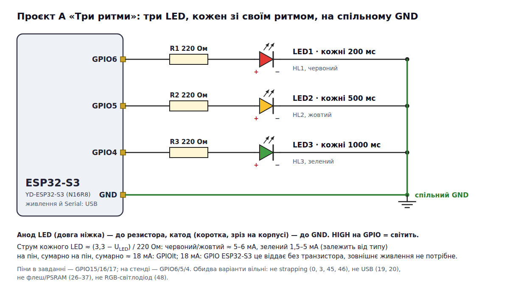
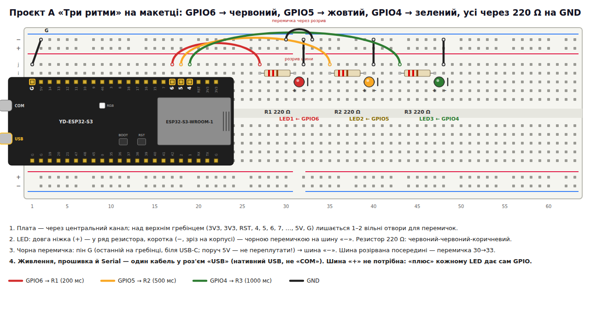

# ESP32-S3: «Три ритми» — Проєкт A

Три LED блимають у різних ритмах **одночасно**: LED1 перемикається кожні 200 мс, LED2 — 500 мс,
LED3 — 1000 мс. Лише `millis()`, без `delay()` і `while()` у `loop()`. Раз на секунду в Serial —
скільки разів прокрутився `loop()`.

```bash
cd esp32-s3-three-rhythms/cpp && pio run -t upload && pio device monitor   # C++: src/main.cpp
cd esp32-s3-three-rhythms/rust && cargo run --release                      # Rust: src/main.rs
```

## Схема





```
GPIO6 ── 220 Ом ── LED1 червоний ──┐
GPIO5 ── 220 Ом ── LED2 жовтий  ───┤
GPIO4 ── 220 Ом ── LED3 зелений ───┤
GND ───────────────────────────────┴── спільний GND
```

Довга ніжка LED — до резистора, коротка — до GND. У завданні піни GPIO15/16/17; GPIO6/5/4 теж вільні
(не strapping 0/3/45/46, не USB 19/20, не флеш/PSRAM 26–37).

## Як це працює

У кожного LED — своя трійка: **період + останній момент + стан**. Кожен прохід `loop()` перевіряє
«чи минув мій період?» і одразу йде далі — ніхто не чекає, тому ритми не заважають один одному:

```cpp
if (now - last1 >= P1) { last1 = now; s1 = !s1; digitalWrite(LED1, s1); }
```

`T1`, `T2`, `T3` як імена не годяться: у ядрі Arduino для ESP32-S3 це вже константи touch-пінів,
тому періоди названо `P1`, `P2`, `P3`.

На платі ([`results/serial-rhythms-cpp.txt`](results/serial-rhythms-cpp.txt)):

```
Три ритми: 200 / 500 / 1000 мс
Loops/s: 696546
```

## Експеримент: `delay(100)` в одному блоці

Розкоментуйте `delay(100)` у блоці LED1. LED1 блимає як раніше, а LED2 і LED3 запізнюються до 100 мс,
коли їхній момент припадає на паузу, — ритм стає нерівним. `Loops/s` падає в рази: 5 разів на секунду
цикл стоїть по 100 мс. Причина: `loop()` один на всіх, і `delay()` зупиняє весь цикл, а не один блок.
Прибрати: видалити `delay()`; потрібна пауза — це ще один таймер, а не очікування.

## Ускладнена версія

1. **Зависання 50 мс раз на секунду.** Перемикання LED1, що припаде на зависання, запізниться до 50 мс:
   один інтервал стане ~250 мс, а з `last1 = now` запізнення лишається й зсуває всі наступні. Висновок:
   найгірше запізнення будь-якої задачі = найдовший блок у циклі, тож кожна дія в циклі має бути швидкою.
2. **4-й і 5-й LED без копіювання.** Задача = пін + період + останній момент + стан → структура й масив:
   ```cpp
   struct Task { uint8_t pin; uint32_t period, last; bool on; };
   Task tasks[] = {{6, 200}, {5, 500}, {4, 1000}, {7, 300}, {15, 700}};
   // loop(): for (auto& t : tasks) if (now - t.last >= t.period) { t.last = now; t.on = !t.on; digitalWrite(t.pin, t.on); }
   ```
3. **Транзисторний ключ.** Код не змінюється: NPN «на землі» вмикає навантаження тим самим HIGH. Змінюється
   схема: GPIO → 1 кОм → база, емітер → GND, навантаження між «+» і колектором, спільна земля, для котушки —
   зворотний діод (див. [`esp32-s3-bright-module`](../esp32-s3-bright-module/)).
