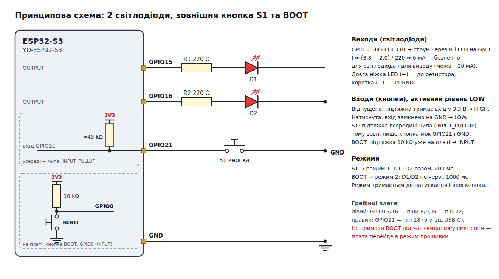
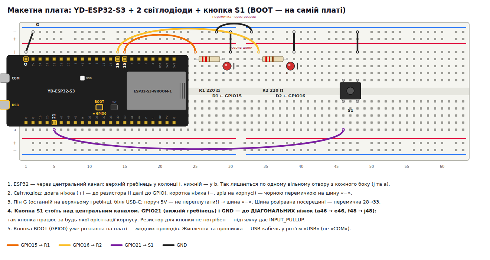

# ESP32-S3: два світлодіоди, зовнішня кнопка та BOOT

Модуль 1.4, домашнє завдання. Два LED блимають в одному з двох режимів, режим вибирають дві кнопки.
Вибраний режим лишається, доки не натиснути **іншу** кнопку; після скидання — знову режим 1.

| Кнопка | Режим | Ефект |
|--------|-------|-------|
| S1 (зовнішня, GPIO21) | **1** (стартовий) | обидва LED разом: 200 мс світять, 200 мс ні |
| BOOT (на платі, GPIO0) | **2** | по черзі, «переїзд»: 1000 мс D1, 1000 мс D2 |

```bash
cd esp32-s3-two-buttons/cpp && pio run -t upload && pio device monitor   # C++: src/main.cpp
cd esp32-s3-two-buttons/rust && cargo run --release                      # Rust: src/main.rs
```

Інтерактивно: [стенд](https://grok-rs.github.io/platformio-projects/lab/#two-buttons) ·
[підтяжка входу](https://grok-rs.github.io/platformio-projects/pull-resistors/).

## Схема





```
GPIO15 ── 220 Ом ── D1 ──┐
GPIO16 ── 220 Ом ── D2 ──┤
GPIO21 ── S1 ────────────┤   INPUT_PULLUP (внутрішні ~45 кОм до 3.3 В)
GND ─────────────────────┘
GPIO0  ── BOOT (на платі, підтяжка 10 кОм уже розпаяна) → INPUT
```

Плату ставте гребінцями в колонки `i` і `b`, щоб з обох боків лишився вільний отвір (GPIO21 — на
нижньому гребінці). `G` лівого гребінця стоїть поруч із `5V` — не переплутайте. Кнопку S1 — над
центральним каналом, **діагональні** ніжки. Струм LED: `(3.3 − 2.0) В / 220 Ом ≈ 6 мА`.

## Як це працює

«Пам'ять» — глобальна `mode`: її змінює лише натиснута кнопка, решту часу значення зберігається.
Миготіння без `delay()`: `loop()` щопроходу опитує кнопки й перевіряє, чи минула половина такту.

```cpp
if (digitalRead(BTN) == LOW) setMode(1);
else if (digitalRead(BOOT) == LOW) setMode(2);

uint32_t period = (mode == 1) ? 200 : 1000;
if (millis() - last >= period) { last = millis(); phase = !phase; show(); }
```

`show()` пише `phase` на D1, а на D2 — той самий `phase` у режимі 1 і протилежний у режимі 2.
`setMode()` починає новий режим одразу й друкує `Mode -> 1 (sync, 200 ms)` /
`Mode -> 2 (alternate, 1000 ms)`. Якщо тримати обидві кнопки, перемагає S1.

**Чому не `delay()`.** З `delay(1000)` кнопки читаються раз на 2 с, і коротке натискання губиться.

**Чому без антибрязкоту.** Кнопка не *перемикає*, а *встановлює* режим: десять разів записати
`mode = 1` — те саме, що один.

## Перевірка

1. Після старту обидва LED блимають швидко й разом, у моніторі `Start mode: 1 (sync, 200 ms)`.
2. BOOT → по черзі й повільно, `Mode -> 2 (alternate, 1000 ms)`; повторне BOOT нічого не змінює.
3. S1 → знову режим 1. RST → програма стартує в режимі 1.

Якщо після RST програма не стартує — під час скидання була натиснута BOOT (плата в режимі прошивки).

## Контрольні питання

1. **`INPUT` / `INPUT_PULLUP` / `OUTPUT`?** Вхід без підтяжки / вхід із внутрішнім резистором до 3.3 В /
   вихід, що сам задає 0 або 3.3 В.
2. **Вхід без підтяжки?** «Висить», ловить наводки й читає випадкові `HIGH`/`LOW` — режим скакав би сам.
3. **Чому S1 — `INPUT_PULLUP`, а BOOT — `INPUT`?** Для S1 зовнішнього резистора немає, у BOOT він уже на платі.
4. **Чому натиснута = `LOW`?** Кнопка замикає вивід на GND, а підтяжка тримає `HIGH`, коли відпущена.
5. **Струм LED:** `(3.3 − 2.0) / 220 ≈ 6 мА`.
6. **Чому не тримати GPIO0 під час увімкнення?** Це strapping-пін: `LOW` при старті = режим прошивки.
