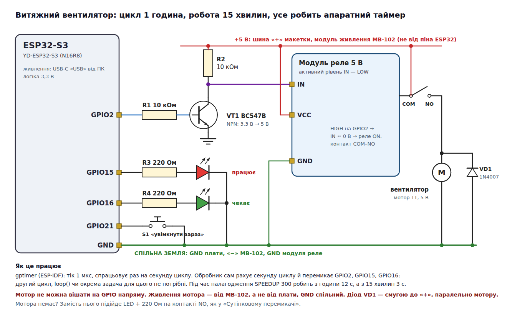
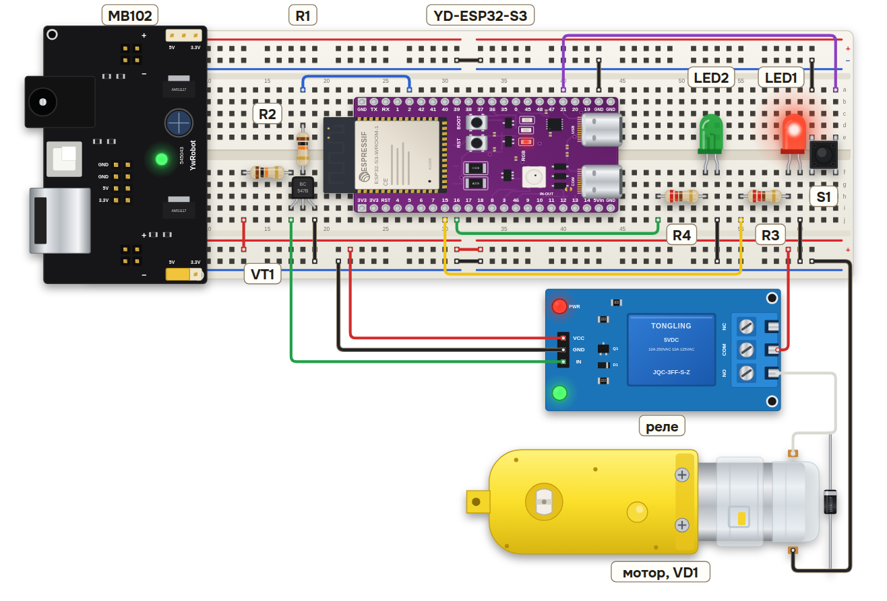
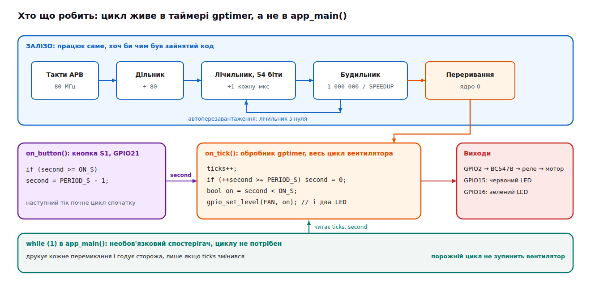
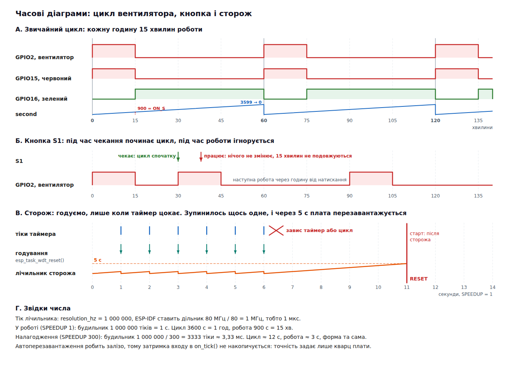

# ESP32-S3: витяжний вентилятор на апаратному таймері (ESP-IDF) — ДЗ модуля 2.5

Вентилятор щогодини вмикається на 15 хвилин і сам вимикається. Цикл веде **апаратний таймер**: його обробник
рахує секунди циклу й перемикає вихід, тому `delay()`, `loop()` і окрема задача для циклу не потрібні.
Прошивка на **ESP-IDF** (`framework = espidf`): `app_main()`, `gptimer`, `gpio_isr_handler_add`, `esp_task_wdt`.

| Вимога завдання | Як зроблено |
|---|---|
| Вентилятор = двигун або реле | GPIO2 → BC547B → модуль реле 5 В, контакт NO → мотор TT (без мотора підійде LED + 220 Ом) |
| Таймери незалежні від коду в циклі | усе в `on_tick()`: це обробник переривання `gptimer`, а не цикл `app_main()` |
| Без `delay()` у завданні | у циклі вентилятора його немає; `vTaskDelay(2000 мс)` на старті лише чекає монітор порту |
| Цикл без участі `loop()` / task | цикл `while (1)` в `app_main()` можна спорожнити: вентилятор працюватиме так само |
| Час задано макросами | `PERIOD_S`, `ON_S` |
| Налагодження | `SPEEDUP 300`: 1 година → 12 с, 15 хвилин → 3 с. У роботі поставте `1` |

Опційне теж є: **логування станів** (`app_main()` друкує кожне перемикання), **LED-індикатори** (GPIO15 працює,
GPIO16 чекає), **захист від повторного запуску** (кнопка GPIO21 під час роботи нічого не робить) і **Watchdog**.

```bash
cd esp32-s3-vent-timer/cpp  && pio run -t upload && pio device monitor   # C, ESP-IDF: src/main.c
cd esp32-s3-vent-timer/rust && cargo run --release                       # Rust, ESP-IDF: src/main.rs
```

Перше збирання завантажує ESP-IDF 6.1 з тулчейном, це кілька хвилин. У теці `cpp/` тут C, а не C++: ESP-IDF пишеться
на C, як і в [`esp32-s3-debounce-idf`](../esp32-s3-debounce-idf/). Rust-варіант теж на ESP-IDF: esp-idf-hal, див. [C ↔ Rust](#c--rust).

Теорія: [урок 2.5 на сайті](https://grok-rs.github.io/platformio-projects/lessons/2-5/).

> **Статус.** Обидві прошивки зібрані (C на ESP-IDF 6.1.0, Rust на esp-idf-hal з ESP-IDF 5.5), логіку C перевірено симуляцією на ПК
> ([`results/simulation-on-pc.txt`](results/simulation-on-pc.txt)), але на платі вони ще не запускалися: плати під рукою
> не було. Симуляція не є результатом виконання. Для здачі потрібен запис із вашої плати, див.
> [Що здати](#що-здати-в-lms).

## Деталі

| Позначення | Деталь | Шт. | Для чого |
|---|---|---|---|
| — | YD-ESP32-S3 (N16R8), кабель USB-C | 1 | керування |
| — | Макетка, модуль живлення MB-102, блок 6,5–12 В або USB | 1 | живлення 5 В для реле й мотора |
| R1, R2 | резистор 10 кОм | 2 | база VT1 і підтяжка IN до 5 В |
| VT1 | BC547B | 1 | перетворює 3,3 В на 5 В для IN |
| — | модуль реле 5 В, активний LOW | 1 | вмикає вентилятор |
| M | мотор TT 5 В (або LED + 220 Ом) | 1 | вентилятор |
| VD1 | 1N4007 | 1 | гасить викид від мотора |
| R3, R4 | резистор 220 Ом | 2 | LED |
| HL1, HL2 | LED червоний, зелений | 2 | працює / чекає |
| S1 | тактова кнопка | 1 | увімкнути зараз |

## Схема



```
GPIO2  ── 10 кОм ── BC547B ── IN модуля реле   (R2 10 кОм від IN до +5 В)
GPIO15 ── 220 Ом ── LED червоний ── GND        працює
GPIO16 ── 220 Ом ── LED зелений ─── GND        чекає
GPIO21 ── кнопка ── GND                        «увімкнути зараз», INPUT_PULLUP
+5 В MB-102 ── COM реле, NO ── мотор ── GND    1N4007 паралельно мотору, смугою до +
```

Керування реле те саме, що в [«Сутінковому перемикачі»](../esp32-s3-twilight-relay/): HIGH на GPIO2 вмикає реле.
GND плати, MB-102 і модуля реле — спільний.

## Макетка



| № | Звідки | Куди | Дріт на малюнку |
|---|---|---|---|
| 1 | MB-102, нижня сторона | перемичка **5V**, нижні шини «+» і «−» | — |
| 2 | GND плати | верхня шина «−», розриви шин закрити перемичками | чорний |
| 3 | GPIO2 | R1 10 кОм → база VT1 | синій |
| 4 | емітер VT1 | нижня шина «−» | чорний |
| 5 | колектор VT1 | R2 10 кОм → нижня шина «+» | червоний |
| 6 | колектор VT1 | IN модуля реле | зелений |
| 7 | VCC і GND модуля реле | нижні шини «+» і «−» | червоний, чорний |
| 8 | COM реле | нижня шина «+» | червоний |
| 9 | NO реле | вивід мотора | білий |
| 10 | другий вивід мотора | шина «−» | чорний |
| 11 | 1N4007 | паралельно мотору, смужка до виводу з NO | — |
| 12 | GPIO15 | R3 220 Ом → червоний LED → «−» | жовтий |
| 13 | GPIO16 | R4 220 Ом → зелений LED → «−» | зелений |
| 14 | GPIO21 | S1 → верхня шина «−» | фіолетовий |

Перед увімкненням: BC547B тримайте пласким боком до себе й звірте C-B-E з даташитом; 5 В не йде на жоден пін ESP32;
мультиметром у режимі прозвонки немає короткого між «+» і «−». Спершу можна перевірити все без мотора: реле клацає, LED
міняються.

Цю макетку перевірено тими самими інструментами, що й сайт: дроти не перетинаються, шини з'єднані.

## Як це працює





```c
static bool IRAM_ATTR on_tick(gptimer_handle_t timer, const gptimer_alarm_event_data_t* event, void* arg) {
    ticks++;
    if (++second >= PERIOD_S) second = 0;
    bool on = second < ON_S;
    gpio_set_level(FAN, on);
    gpio_set_level(LED_RUN, on);
    gpio_set_level(LED_WAIT, !on);
    return false;  // жодну задачу будити не треба
}
```

**Один таймер, а не два.** Здавалося б, потрібні два: «раз на годину» і «15 хвилин». Але обидва числа — це просто
положення в циклі: `second` бігає від 0 до 3599, і вентилятор працює, поки `second < 900`. Другий таймер довелося б
запускати й зупиняти з обробника першого, а один лічильник простіший і не може розсинхронізуватися.

**Час не пливе.** Період перезапускає залізо (`flags.auto_reload_on_alarm = true`), а не код, тому затримка входу в обробник не
накопичується. Точність визначає лише кварц плати.

**Дільник.** `resolution_hz = 1000000`: тік 1 мкс, дільник ESP-IDF підбирає сам. `alarm_count = 1000000 / SPEEDUP`:
спрацювання раз на секунду циклу. Обробник повертає `false`: він нікого не будить, тож перемикання задач не потрібне.

**Виводи.** FAN налаштовано як `GPIO_MODE_INPUT_OUTPUT`: у режимі лише `OUTPUT` `gpio_get_level()` повертає 0, а цикл
друку читає саме стан виходу.

**Захист від повторного запуску.** Кнопка працює лише тоді, коли вентилятор чекає: ставить `second = PERIOD_S - 1`,
і наступний тік починає цикл спочатку. Натискання під час роботи ігнорується: 15 хвилин не подовжуються, брязкіт
кнопки теж нічого не зламає. Цикл після ручного запуску відлічується від цього моменту.

**Watchdog.** Сторож задач ESP-IDF запускає сам; `esp_task_wdt_reconfigure()` ставить 5 с і перезавантаження
(`trigger_panic = true`), `esp_task_wdt_add(NULL)` підписує `app_main`. Цикл годує сторожа, тільки якщо `ticks`
змінився. Тому він стереже одразу двох: завис цикл або зупинився таймер — через 5 с перезавантаження. Після нього в першому рядку буде `старт: після сторожа`, а цикл
почнеться спочатку. Перевірити можна так: додайте в цикл `while (1)` рядок `while (1) {}`.

## Перевірка

Serial за `SPEEDUP 300` має виглядати так. Це вивід симуляції, на платі мілісекунди будуть трохи іншими:

```
Вентилятор: цикл 3600 с, робота 900 с, прискорення ×300, старт: звичайний
[2000 мс] ПРАЦЮЄ, секунда циклу 600
[3000 мс] чекає, секунда циклу 900
[11999 мс] ПРАЦЮЄ, секунда циклу 0
[14999 мс] чекає, секунда циклу 900
```

Перший рядок стану з'являється після `vTaskDelay(pdMS_TO_TICKS(2000))` на старті, тому секунда циклу там уже не 0.

| Перевірка | Що зробити | Правильний результат | Симуляція | Плата |
|---|---|---|---|---|
| Цикл | дивитися 2 цикли | робота ≈ 3 с, період ≈ 12 с | так | |
| Індикатори | дивитися на LED | червоний лише під час роботи, зелений навпаки | так | |
| Реле і мотор | дивитися й слухати | клацає й крутить разом із червоним LED | — | |
| Незалежність від циклу | у `while (1)` додати `vTaskDelay(pdMS_TO_TICKS(4000));` | цикл той самий, лише друк запізнюється | — | |
| Кнопка, чекає | натиснути під час зеленого | одразу новий цикл | так | |
| Кнопка, працює | натиснути під час червоного | робота не подовжилась | так | |
| Сторож | у `while (1)` додати `while (1) {}` | через 5 с перезавантаження, `старт: після сторожа` | так (зупинка таймера) | |
| Справжній час | `SPEEDUP 1`, за бажанням на годину | 15 хв роботи, 45 хв очікування | — | |

Запустити симуляцію самому: `docs/tools/host_replay/run.sh`. Перемалювати діаграми: `docs/tools/render.sh`,
макетку: `docs/tools/export_breadboard.sh`.

## Що здати в LMS

1. Прошийте, пройдіть таблицю вище й збережіть лог: `pio device monitor -f log2file`. Покладіть його в
   `results/serial-cpp.txt`. Бажано додати коротке відео циклу.
2. Запуште репозиторій і вставте в домашнє завдання посилання та текст:

```
Код і результат: https://github.com/grok-rs/platformio-projects/tree/main/esp32-s3-vent-timer
Один апаратний таймер веде весь цикл із обробника: 1 година / 15 хвилин задаються макросами PERIOD_S і ON_S,
delay() у циклі немає, цикл app_main() потрібен лише для логу. Прошивка на ESP-IDF (gptimer). Для налагодження SPEEDUP 300: година за 12 с.
Опційне: логування станів, LED-індикатори, захист від повторного запуску, Watchdog.
```

## C ↔ Rust

Обидві прошивки на ESP-IDF і FreeRTOS: C викликає функції ESP-IDF напряму, Rust — через обгортки
[esp-idf-hal](https://github.com/esp-rs/esp-idf-hal) зі стандартною бібліотекою (`std`, `println!`).

| | C (ESP-IDF 6.1) | Rust (esp-idf-hal, ESP-IDF 5.5) |
|---|---|---|
| Таймер | `gptimer_new_timer()` + `gptimer_set_alarm_action()` | `TimerDriver::new()` + `set_alarm_action(AlarmConfig {…})` — той самий gptimer |
| Обробник | `static bool IRAM_ATTR on_tick(…)` | замикання в `timer.subscribe(move \|_\| {…})`, виводи переносяться в нього |
| Кнопка | `gpio_isr_handler_add()` | `button.subscribe(on_button)`; esp-idf-hal вимикає переривання після спрацювання, тому цикл знову викликає `enable_interrupt()` |
| Спільні дані | `volatile` | `AtomicU32`, `AtomicBool` |
| Стан вентилятора для друку | `gpio_get_level(FAN)`, вивід у режимі INPUT_OUTPUT | `FAN_ON`, який пише обробник |
| Сторож | `esp_task_wdt_reconfigure()` + `esp_task_wdt_add(NULL)` | `TWDTDriver::new()` + `watch_current_task()`, годування `watch.feed()` |
| Час для логу | `esp_timer_get_time()` | `EspTaskTimerService::now()` |
| Збирання | PlatformIO, `framework = espidf` | Cargo, ціль `xtensa-esp32s3-espidf`, ESP-IDF збирає `esp-idf-sys` |

Rust-проєкт — окремий робочий простір Cargo (решта репозиторію на esp-hal без ОС). Потрібні тулчейн `esp`
(`espup install`), `source ~/export-esp.sh` і `cargo install ldproxy`. Перше `cargo build` завантажує й збирає
ESP-IDF у `rust/.embuild/`, це надовго.
